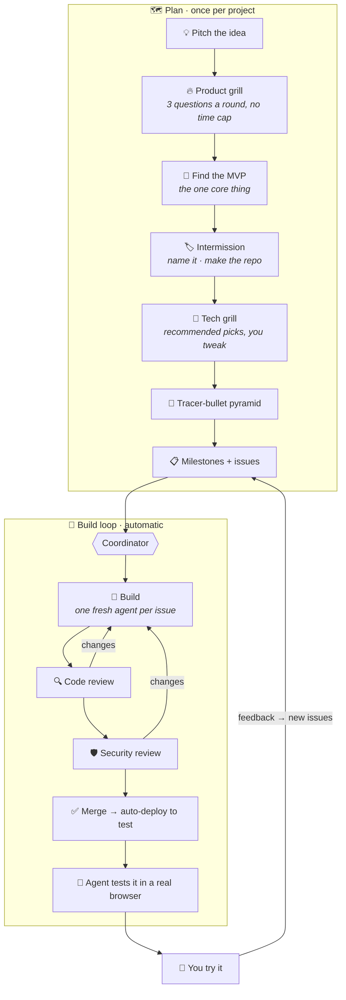

<p align="center">
  
</p>

<p align="center">
  <a href="#-quick-start"></a>
  <a href="#-quick-start"></a>
  <a href="LICENSE"></a>
</p>

<p align="center">
  <b>Copy four things into your repo. Say <code>new-project</code>. Get grilled, get a plan, and watch agents build, review, secure, merge and test it.</b>
</p>

<p align="center">
  <a href="#-quick-start">Quick start</a> ·
  <a href="#-how-it-works">How it works</a> ·
  <a href="#-the-tracer-bullet-pyramid">The pyramid</a> ·
  <a href="#-model-routing">Model routing</a> ·
  <a href="#-skills">Skills</a> ·
  <a href="guide/cheat-sheet.md">Cheat sheet</a>
</p>

---

## 🧠 Why this exists

AI is a program. It does what you tell it, and when you don't tell it, it guesses. It takes the first solution that works, invents its own UI components, and writes 4,000-line files. It ships features nobody asked for and skips the ones you assumed it knew about.

This kit tells it. Rules that load every session, skills that load when they're needed, and a workflow that goes:

> **Decide the product → decide the tech → slice it thin → let agents build, review and test → you try it → repeat.**

It's the workflow I use to run several apps at once while holding down a full-time contract, and it's written so you can copy it into any repo tonight.

---

## ⚡ Quick start

**1. Copy the kit into your project folder,** new or existing.

macOS / Linux:

```bash
git clone --depth 1 https://github.com/jsmigendevelopment/AI-Dev-Workflow /tmp/ai-dev-workflow
```

```bash
cp /tmp/ai-dev-workflow/AGENTS.md /tmp/ai-dev-workflow/CLAUDE.md .
```

```bash
cp -r /tmp/ai-dev-workflow/.agents /tmp/ai-dev-workflow/.claude .
```

```bash
mkdir -p .github && cp -r /tmp/ai-dev-workflow/.github/ISSUE_TEMPLATE .github/
```

Windows (PowerShell):

```powershell
git clone --depth 1 https://github.com/jsmigendevelopment/AI-Dev-Workflow "$env:TEMP\ai-dev-workflow"
```

```powershell
Copy-Item "$env:TEMP\ai-dev-workflow\AGENTS.md", "$env:TEMP\ai-dev-workflow\CLAUDE.md" .
```

```powershell
Copy-Item -Recurse "$env:TEMP\ai-dev-workflow\.agents", "$env:TEMP\ai-dev-workflow\.claude" .
```

```powershell
New-Item -ItemType Directory -Force .github | Out-Null; Copy-Item -Recurse "$env:TEMP\ai-dev-workflow\.github\ISSUE_TEMPLATE" .github
```

> [!NOTE]
> **Your repo already has an `AGENTS.md`?** Copy this one in as `AGENTS.kit.md` instead, and let `join-project` merge the two.

**2. Open Claude Code or Codex in that folder and say one of these:**

| Situation | Claude Code | Codex | Or just say |
|---|---|---|---|
| 💡 New app from an idea | `/new-project` | `$new-project` | "I have an idea for an app" |
| 🧭 Joining an existing repo | `/join-project` | `$join-project` | "Help me get set up in this repo" |
| ☀️ Any new session after that | `/new-session` | `$new-session` | "Pick up where we left off" |

That's it. Those three are the only commands to remember. Everything else is called for you.

---

## 🔁 How it works



### The steps in plain English

1. **Pitch it.** Tell the AI your idea in your own words.
2. **Get grilled on the product.** Three questions at a time, each with a recommended answer. It covers who it's for, the main flow, the features, and the decisions people always forget (sign-up, deleting data, payments, accessibility). It ends when the AI runs out of questions, not when you get tired.
3. **Find the MVP.** The one core piece that makes the app stand out. Not the whole app.
4. **Name it and make the repo.** You can't name something before you know what it is.
5. **Tech grill.** Platform, stack, folder structure, API pattern, data, UI kit and infra. The AI recommends each one, a beginner accepts and an expert overrides. Crucial unknowns get **deep research** first.
6. **Plan the pyramid.** Thin vertical slices, stacked into passes.
7. **Write the issues.** The strongest model writes each one, with acceptance checks, an out-of-scope fence, dependencies, priority, model, effort, and the skills to load.
8. **Start the loop.** The coordinator assigns issues and sends each PR through a review, then a security review, then merge.
9. **Auto-test.** A merge deploys to test, and an agent clicks through the change in a real browser before telling you it's ready.
10. **Try it.** Your feedback becomes new issues, and the loop keeps going.

📄 One-page version: **[guide/cheat-sheet.md](guide/cheat-sheet.md)**

---

## 🔺 The tracer-bullet pyramid

<p align="center">
  
</p>

The old way builds the whole schema, then the whole API, then the whole UI, and you see nothing until the end. **Tracer bullets** cut thin slices that go all the way through, so you can use something real after the first one and steer the AI while it's cheap.

The MVP isn't one slice or one pass, so the slices **stack**:
- **Pass 1** is wide and thin: every slice working end to end.
- **Each pass up** is narrower and deeper.
- **The core** gets the most passes and the strongest models.

→ [Full skill](.agents/skills/tracer-bullet-pyramid/SKILL.md)

---

## 🎛️ Model routing

Picking the model, the provider and the effort is a skill of its own. Strongest-on-high for everything is slow and burns your limits. Cheapest for everything ships junk.

| Job | Tier · effort | Example |
|---|---|---|
| 🗣️ The coordinator you talk to all day | Everyday · **low** | Opus 5.5 low |
| 🔥 Grill and planning | Everyday · medium | Opus 5.5 medium |
| 🔬 Deep research, schema, API, wireframes, writing issues | **Strongest · high** | Fable 5.2 high |
| 🎨 Art and visual ideas | Creative | ChatGPT, top model |
| 🔨 First build of every slice (MVP) | Everyday · **low** | Opus 5.5 low |
| ✨ Upgrade passes on the core | Everyday · medium | Opus 5.5 medium |
| 🔍 Code review | Everyday · **low** | More effort didn't catch more bugs |
| 🛡️ Security review | One step above the reviewer · strongest for personal data or money | Opus medium / Fable |

**Start low. Escalate one step only after a verified failure.** → [Full skill](.agents/skills/model-routing/SKILL.md)

---

## 🧰 Skills

Skills only load reliably when something names them. In my tests, an unnamed skill loaded **0 of 50** times, and a named one **50 of 50**. So `AGENTS.md` names every skill, and every issue has a `Skills:` line.

### Primary: you call these

| Skill | What it does |
|---|---|
| [`new-project`](.agents/skills/new-project/SKILL.md) | Idea → grill → MVP → name → tech → pyramid → issues → ready to build |
| [`join-project`](.agents/skills/join-project/SKILL.md) | Map the repo → run it → grill you on what the code can't say → write `AGENTS.md` + `docs/` |
| [`new-session`](.agents/skills/new-session/SKILL.md) | Read the state → check the board → ask who else is working → pick the work → offer to start the loop |

### Secondary: called for you

| Skill | What it does |
|---|---|
| [`grill`](.agents/skills/grill/SKILL.md) | The interview: three a round, recommended answers, staged coverage map, nothing skipped |
| [`name-the-app`](.agents/skills/name-the-app/SKILL.md) | The intermission: names, then repo visibility and licence |
| [`tech-grill`](.agents/skills/tech-grill/SKILL.md) | Platform → stack → architecture → API → data → UI → auth → infra, each recommended with alternatives |
| [`deep-research`](.agents/skills/deep-research/SKILL.md) | Crucial unknowns get a dated dossier and a recommendation before anyone decides |
| [`tracer-bullet-pyramid`](.agents/skills/tracer-bullet-pyramid/SKILL.md) | Slices and passes |
| [`write-issues`](.agents/skills/write-issues/SKILL.md) | Issues an agent can build alone ([template](.github/ISSUE_TEMPLATE/slice.md)) |
| [`model-routing`](.agents/skills/model-routing/SKILL.md) | The right model and effort for each job |
| [`coordinator`](.agents/skills/coordinator/SKILL.md) | The automated build → review → security → merge → test loop |
| [`build-issue`](.agents/skills/build-issue/SKILL.md) | One issue, one fresh session, inside the fence |
| [`code-review`](.agents/skills/code-review/SKILL.md) | A fresh reviewer that sees the diff, not the author's story |
| [`security-review`](.agents/skills/security-review/SKILL.md) | The second gate: auth, input, secrets, data, abuse |
| [`browser-test`](.agents/skills/browser-test/SKILL.md) | An agent clicks through the change before you ever see it |

---

## 🏗️ The default stack (recommended, never forced)

The tech grill recommends these for a web app and shows alternatives for each. Take them or swap any of them.

| | Pick | Why |
|---|---|---|
| Framework | **TanStack Start** (React + TypeScript) | Fast, typed, and not tied to one host |
| UI | **shadcn/ui + Tailwind** | Without a kit, AI invents its own components |
| Structure | **Feature modules**, Bulletproof React style | Features don't tangle. Any one can be lifted into its own service later |
| API | **Controller → service → repository** | Easy to test, easy to swap parts in |
| Data | **SQLite** → Supabase Postgres when you outgrow it | Free, simple, self-hostable |
| Auth | **Clerk** | Don't build auth. Buy it, then you don't have to review it |
| Tests | **Vitest + Playwright** | Unit tests for logic, a real browser for flows |

**Build vs buy, always in this order:** open source → a SaaS with a free tier → build it yourself.

---

## 💡 Principles

- **Words are switches.** "Grill me", "tracer bullets", "three options with trade-offs", "modular monolith", "review in a fresh context". [Full list →](guide/principles.md#2-words-are-switches)
- **Don't *let* it ask, *make* it ask.** "You may ask" got questions in 4 of 24 runs. "Ask three" surfaced 39 of 48 hidden decisions.
- **AI finds *a* solution, not *the* solution.** That's what the grill and deep research are for.
- **Readable for people = readable for AI.**
- **Product before tech.** You can't pick a stack before you know whether it's a website or an iPhone app.
- **Your speed depends on where you work.** A startup can let agents merge. A bank can't. Set your **risk dial**.

📄 [All principles](guide/principles.md) · 📊 [The evidence behind them](guide/evidence.md)

---

## 📁 What's in here

```
AGENTS.md                  ← rules every agent follows, every session (Codex + Claude)
CLAUDE.md                  ← one line: @AGENTS.md
.agents/skills/            ← the skills, master copy (Codex reads this)
.claude/skills/            ← same skills (Claude Code reads this)
.github/ISSUE_TEMPLATE/    ← the slice issue template
guide/                     ← cheat sheet, principles, evidence (for people)
assets/                    ← diagrams
scripts/sync-skills.mjs    ← keeps the two skill folders identical
```

**Editing a skill?** Edit it in `.agents/skills/`, then run:

```bash
node scripts/sync-skills.mjs
```

CI fails if the two copies drift apart.

---

<p align="center">
  <sub>Built and battle-tested by</sub><br><br>
  <a href="https://me.jsmigen.dev"><b>✦ jay ✦</b></a><br>
  <sub>Jay Smigen · software engineer · New Jersey</sub><br><br>
  <a href="https://me.jsmigen.dev">me.jsmigen.dev</a> ·
  <a href="https://jsmigen.dev">jsmigen.dev</a> ·
  <a href="https://www.linkedin.com/in/jayson-smigen/">LinkedIn</a> ·
  <a href="https://github.com/Jay-Smi">GitHub</a>
  <br><br>
  <sub>Made for the builders. Go ship something. ✌️</sub>
</p>
