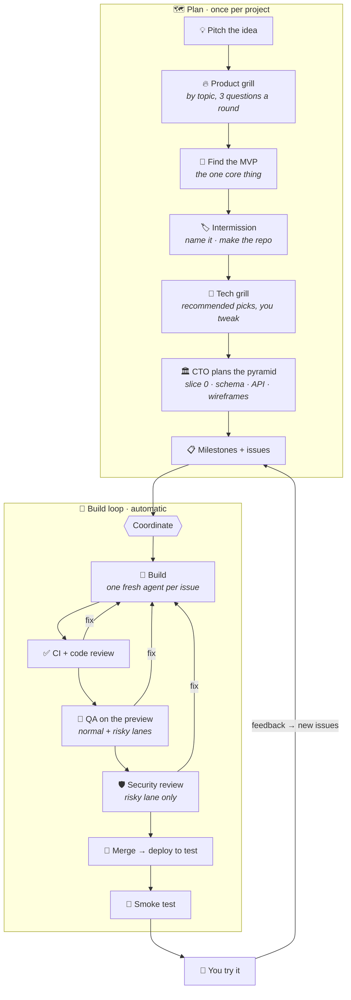

<p align="center">
  
</p>

<p align="center">
  <a href="#-quick-start"></a>
  <a href="#-quick-start"></a>
  <a href="LICENSE"></a>
</p>

<p align="center">
  <b>Copy the kit into your repo. Type <code>/idea</code>. Get grilled, get a plan, and watch agents build, check, review, merge and test it.</b>
</p>

<p align="center">
  <a href="#-quick-start">Quick start</a> ·
  <a href="#-how-it-works">How it works</a> ·
  <a href="#-the-tracer-bullet-pyramid">The pyramid</a> ·
  <a href="#-model-routing">Model routing</a> ·
  <a href="#-skills">Skills</a> ·
  <a href="guide/cheat-sheet.md"><b>Cheat sheet</b></a>
</p>

---

## 🧠 Why this exists

AI is a program. It does what you tell it, and when you don't tell it, it guesses. It takes the first solution that works, invents its own UI components, and writes 4,000-line files. It ships features nobody asked for and skips the ones you assumed it knew about.

This kit tells it. Rules load every session, skills load when a request names them, and the workflow goes:

> **Decide the product → decide the tech → slice it thin → let agents build, check, review and test → you try it → repeat.**

It's the workflow I use to run several apps at once alongside a full-time contract.

---

## ⚡ Quick start

**1. Get the kit into your project folder,** new or existing.

**The quickest way** (Node 22+), in your project folder:

```bash
npx ai-dev-workflow init
```

It never overwrites your files. Later, `npx ai-dev-workflow@latest update` brings in new kit versions, `npx ai-dev-workflow doctor` checks your setup, and `npx ai-dev-workflow add tanstack-start` drops in a stack pack.

Or open Claude Code or Codex in the folder and paste this:

```text
Install the AI-Dev-Workflow kit from https://github.com/jsmigendevelopment/AI-Dev-Workflow into this folder: copy AGENTS.md, CLAUDE.md, .agents/, .claude/, .codex/ and .github/ISSUE_TEMPLATE/. Don't overwrite an existing AGENTS.md or CLAUDE.md; show me what you'd merge instead. Then tell me which command to type next.
```

Or copy it yourself:

macOS / Linux:

```bash
git clone --depth 1 https://github.com/jsmigendevelopment/AI-Dev-Workflow /tmp/ai-dev-workflow
```

```bash
cp /tmp/ai-dev-workflow/AGENTS.md /tmp/ai-dev-workflow/CLAUDE.md .
```

```bash
cp -r /tmp/ai-dev-workflow/.agents /tmp/ai-dev-workflow/.claude /tmp/ai-dev-workflow/.codex .
```

```bash
mkdir -p .github && cp -r /tmp/ai-dev-workflow/.github/ISSUE_TEMPLATE .github/
```

Windows (PowerShell):

```powershell
git clone --depth 1 https://github.com/jsmigendevelopment/AI-Dev-Workflow "$env:TEMP\ai-dev-workflow"
```

```powershell
Copy-Item "$env:TEMP\ai-dev-workflow\AGENTS.md", "$env:TEMP\ai-dev-workflow\CLAUDE.md" .
```

```powershell
Copy-Item -Recurse "$env:TEMP\ai-dev-workflow\.agents", "$env:TEMP\ai-dev-workflow\.claude", "$env:TEMP\ai-dev-workflow\.codex" .
```

```powershell
New-Item -ItemType Directory -Force .github | Out-Null; Copy-Item -Recurse "$env:TEMP\ai-dev-workflow\.github\ISSUE_TEMPLATE" .github
```

> [!NOTE]
> **Your repo already has an `AGENTS.md`?** Copy this one in as `AGENTS.kit.md` instead, and `/join` merges the two.
> **Already have a `CLAUDE.md`?** Keep yours and add the line `@AGENTS.md` to it.
> **Using Codex?** Mark the project as trusted when Codex asks. Its project settings and safety rules in `.codex/` only load for trusted projects.

> [!WARNING]
> **Joining a repo you didn't write?** Before you open an agent in it, look over its `.claude/`, `.codex/` and editor settings and its git hooks. Those load as soon as the agent starts.

**2. Open Claude Code or Codex in that folder and type one of these:**

| | Claude Code | Codex | When |
|---|---|---|---|
| 💡 | **`/idea`** | `$idea` | You have an idea for a new app |
| 🧭 | **`/join`** | `$join` | You're new to a repo that isn't set up yet |
| ☀️ | **`/back`** | `$back` | You're starting work, or back from a break |
| 🌙 | **`/afk`** | `$afk` | You're stepping away and want it to keep building |

That's it. Four commands. Everything else is called for you. 📄 **[Cheat sheet →](guide/cheat-sheet.md)**

---

## 🔁 How it works



### The steps in plain English

1. **Pitch it.** Tell the AI your idea in your own words.
2. **Get grilled on the product,** topic by topic: who it's for, the main flow, the features, the decisions people always forget (sign-up, deleting data, payments, accessibility), and the MVP. About 10 questions per topic, three at a time, each with a recommended answer.
3. **Find the MVP.** The one core piece that makes the app stand out. You pick it, never a default.
4. **Name it and make the repo.**
5. **Tech grill.** Platform, stack, folder structure, API pattern, data, UI kit, environments and CI. The AI recommends each one, a beginner accepts and an expert overrides.
6. **The CTO plans.** The strongest model plans slice 0 (CI and a test deploy), the pyramid and the milestones, and designs the schema, API and wireframes.
7. **Write the issues.** Each one has acceptance checks tagged `auto` (CI runs them) or `agent` (an agent clicks through them), a fence, dependencies, risk flags and a lane.
8. **Start the loop.** Build, CI, code review, QA on the preview, a security review for risky changes, merge, smoke test.
9. **Try it.** Your feedback becomes new issues, and the loop keeps going.

---

## 🔺 The tracer-bullet pyramid

<p align="center">
  
</p>

The old way builds the whole schema, then the whole API, then the whole UI, and you see nothing until the end. **Tracer bullets** cut thin slices that go all the way through, so you can use something real after the first one and steer the AI while it's cheap.

The MVP isn't one slice or one pass, so the slices **stack**:
- **Slice 0** is the skeleton: the app runs, CI checks every pull request, main deploys to test.
- **Pass 1** is wide and thin: every slice working end to end.
- **Each pass up** is narrower and deeper.
- **The core** gets the most passes and the most effort.

→ [Full skill](.agents/skills/pyramid/SKILL.md)

---

## 🧠 Model routing

Picking the model, the provider and the effort is a skill of its own. Strongest-on-high for everything is slow and burns your limits. Cheapest for everything ships junk.

| Job | Tier · effort | Example |
|---|---|---|
| 🗣️ Your live thread, the loop | Everyday · **low** | Opus 5.5 low |
| 🔥 Grill and planning chat | Everyday · medium | Opus 5.5 medium |
| 🏛️ **CTO:** research, pyramid, schema, API, wireframes | **Strongest · high** | Fable 5.2 high |
| 📋 Writing issues from the CTO's plan | Everyday · medium | Opus 5.5 medium |
| 🔨 Building pass 1 | Everyday · **low** | Opus 5.5 low |
| ✨ Building pass 2+ | Everyday · medium | Opus 5.5 medium |
| 🔍 Code review | Never below the builder | Opus 5.5 low / medium |
| 🛡️ Security review (risky only) | One step above review, plus a second vendor for personal data or money | Opus 5.5 medium + ChatGPT |
| 🎨 Art | Creative | ChatGPT |

**Start low. Escalate one step only after a verified failure.** → [Full skill](.agents/skills/routing/SKILL.md)

---

## 🧰 Skills

A skill loads reliably when the request names it. In testing, skills nobody mentioned loaded **0 of 40** times on a small model, and one sentence naming the skill got **20 of 20**. So you type the command, every issue has a `Skills:` line, and every skill names the next one.

### Primary: you type these

| Skill | What it does |
|---|---|
| [`/idea`](.agents/skills/idea/SKILL.md) | Pitch → grill → MVP → name → tech → CTO plan → issues → ready to build |
| [`/join`](.agents/skills/join/SKILL.md) | Map the repo → run it → grill you on what the code can't say → write `AGENTS.md` + `docs/` |
| [`/back`](.agents/skills/back/SKILL.md) | Rebuild from the repo → what changed while you were away → who else is working → triage |
| [`/afk`](.agents/skills/afk/SKILL.md) | How long? → usage check → safe unattended rules → watchdog → keep building |

### Secondary: called for you

| Skill | What it does |
|---|---|
| [`grill`](.agents/skills/grill/SKILL.md) | The interview: by topic, three a round, recommended answers, nothing on the floor skipped |
| [`name`](.agents/skills/name/SKILL.md) | The intermission: names, visibility, licence, `git init`, GitHub |
| [`stack`](.agents/skills/stack/SKILL.md) | Platform → stack → architecture → API → data → auth → environments → CI |
| [`research`](.agents/skills/research/SKILL.md) | Crucial unknowns get a fact-checked, dated dossier before anyone decides |
| [`pyramid`](.agents/skills/pyramid/SKILL.md) | The CTO step: slice 0, slices and passes, schema, API, wireframes |
| [`issues`](.agents/skills/issues/SKILL.md) | Issues an agent can build alone ([template](.github/ISSUE_TEMPLATE/slice.md)) |
| [`routing`](.agents/skills/routing/SKILL.md) | The right model and effort for each job |
| [`coordinate`](.agents/skills/coordinate/SKILL.md) | The loop: claim → build → check → merge → smoke test |
| [`build`](.agents/skills/build/SKILL.md) | One issue, one fresh session, tests first, inside the fence |
| [`pr-review`](.agents/skills/pr-review/SKILL.md) | Reads the diff, never the description |
| [`pr-security`](.agents/skills/pr-security/SKILL.md) | The gate for risky changes, against your security policy |
| [`qa`](.agents/skills/qa/SKILL.md) | Clicks through the change on the preview, then smoke-tests after merge |

### Know-how: named in issues when the work needs them

| Skill | Covers |
|---|---|
| [`web-performance`](.agents/skills/web-performance/SKILL.md) | Core Web Vitals, budgets, images, fonts, code splitting |
| [`web-security`](.agents/skills/web-security/SKILL.md) | Bots, spam, abuse, rate limits, headers, trust boundaries |
| [`seo`](.agents/skills/seo/SKILL.md) | Titles, meta, share images, sitemaps, structured data |
| [`a11y`](.agents/skills/a11y/SKILL.md) | WCAG 2.2 AA, keyboard, contrast, forms, axe in Playwright |
| [`dependencies`](.agents/skills/dependencies/SKILL.md) | Picking libraries: maintained, licensed right, pinned |
| [`stack-tanstack-start`](.agents/skills/stack-tanstack-start/SKILL.md) | Applies the TanStack Start pack and its conventions |

---

## 🧱 The default stack (recommended, never forced)

The tech grill recommends these for a web app and shows alternatives for each. Take them or swap any of them.

| | Pick | Why |
|---|---|---|
| Framework | **TanStack Start** (React + TypeScript) | Fast, typed, and not tied to one host |
| UI | **shadcn/ui + Tailwind** | Without a kit, AI invents its own components |
| Structure | **Module-based feature folders** (`src/modules/<feature>/`) | A feature's UI, hooks, server code and schemas live together. Any module can be lifted into its own service later. |
| API | **Controller → service → repository** | Easy to test, easy to swap parts in |
| Boundary check | **eslint-plugin-boundaries** in CI | The architecture holds because a check enforces it, not because a prompt asks |
| Data | **SQLite**, or Supabase Postgres when you need it | Free, simple, self-hostable |
| Auth | **Clerk** | Don't build auth. Buy it. |
| Domain + hosting | **Cloudflare** (Workers, and buy the domain there) · Netlify as the alternative | Generous free tier, at-cost domains |
| Tests | **Vitest + Playwright** | Unit tests for logic, a real browser for flows |

**Build vs buy, always in this order:** open source → a SaaS with a free tier → build it yourself.

### 📦 Stack packs

A stack pack is that stack, already set up and working: configs, the folder skeleton, an example module through every layer, CI and the check contract. At slice 0 the agent pulls it into your project, so every app starts the same way.

| Pack | What's in it |
|---|---|
| [`tanstack-start`](stacks/tanstack-start/) | TanStack Start · shadcn/ui + Tailwind · Drizzle on D1 · Clerk · Vitest + Playwright · Cloudflare Workers |

No pack for your stack? The agent sets up the same things by hand and offers to save it as a new pack.

### ✅ The check contract

Every project, whatever the stack, has the same commands: `check`, `lint`, `typecheck`, `test`, `test:e2e`, `build`. The skills, CI and the loop only ever call those, so the workflow works on any stack.

### 🔒 Guardrails

- **CI on every pull request:** the checks, a secret scan, and a guard that blocks changes to the agents' own rules until you label them `human-approved`.
- **No force pushes, no pushing to main:** blocked at the tool level, which works on free private repos too, where GitHub won't protect branches.
  - Claude Code: `.claude/settings.json` blocks every forced push and every push to main.
  - Codex: `.codex/rules/git-safety.rules` blocks `git push --force …`, `-f`, `--force-with-lease` and pushes to main. Codex rules only match the start of a command, so a `--force` typed after the branch name is caught by the `AGENTS.md` rule instead.
- **GitHub setup, done for you:** at slice 0 the agent runs `setup-github.mjs --dry-run`, shows you the list, and asks before applying it. It turns on whatever your plan allows and says what it skipped:

  | Sets up | Free plan | GitHub Team |
  |---|---|---|
  | The workflow's labels, Dependabot alerts and security-fix PRs | ✅ | ✅ |
  | Rules on main: PR only, no force push, green checks required | public repos | ✅ |
  | `test` and `production` environments. Production deploys only from main and waits for your approval. | public repos | ✅ |
  | Secret scanning and push protection | public repos | add-on for private |
  | Draft PRs until checks pass | public repos | ✅ |

  Code owners and required reviewers only help with teammates: GitHub won't let you approve your own PR.
- **No silent waiting:** when an agent is rate-limited or blocked, it tells you right away, keeps doing other work, and resumes after the reset.

---

## 💡 Principles

- **Words are switches.** "Grill me", "tracer bullets", "three options with trade-offs", "modular monolith", "use the `<name>` skill". [Full list →](guide/principles.md#2-words-are-switches)
- **Don't *let* it ask. *Make* it ask.** Told it *may* ask, it asked in 4 of 24 conversations. Told to **ask three**, matched builds went from 7 of 24 to 19 of 24.
- **AI finds *a* solution, not *the* solution.** That's what the grill and research are for.
- **"Done" is a claim.** Someone other than the builder runs the checks.
- **Readable for people = readable for AI.**
- **Product before tech.** You can't pick a stack before you know whether it's a website or an iPhone app.
- **Your speed depends on where you work.** A startup can let agents merge. A bank can't. Set your **risk dial**. Production, secrets, real data and money always wait for you.

📄 [All principles](guide/principles.md) · 📊 [The evidence behind them](guide/evidence.md)

---

## 📁 What's in here

```
AGENTS.md                  ← rules every agent follows, every session (Codex + Claude)
CLAUDE.md                  ← one line: @AGENTS.md
.claude/settings.json      ← Claude Code: blocks force pushes and pushes to main
.codex/                    ← Codex: project settings and command rules
.agents/skills/            ← the skills, master copy (Codex reads this)
.claude/skills/            ← same skills (Claude Code reads this)
.github/ISSUE_TEMPLATE/    ← the slice issue template
stacks/                    ← stack packs (ready-made starters), pulled in at slice 0
guide/                     ← cheat sheet, principles, evidence (for people)
assets/                    ← diagrams
cli/                       ← the npx ai-dev-workflow command (init, update, doctor, add)
scripts/sync-skills.mjs    ← keeps the copies identical
```

**Editing a skill?** Edit it in `.agents/skills/`, then run:

```bash
node scripts/sync-skills.mjs
```

CI fails if the copies drift apart.

---

<p align="center">
  <sub>Built and battle-tested by</sub><br><br>
  <a href="https://me.jsmigen.dev"><b>✦ jay ✦</b></a><br>
  <sub>Jay Smigen · software engineer · New Jersey</sub><br><br>
  <a href="https://me.jsmigen.dev">me.jsmigen.dev</a> ·
  <a href="https://jsmigen.dev">jsmigen.dev</a> ·
  <a href="https://www.linkedin.com/in/jayson-smigen/">LinkedIn</a> ·
  <a href="https://github.com/Jay-Smi">GitHub</a>
  <br><br>
  <sub>Made for the builders. Go ship something. ✌️</sub>
</p>
