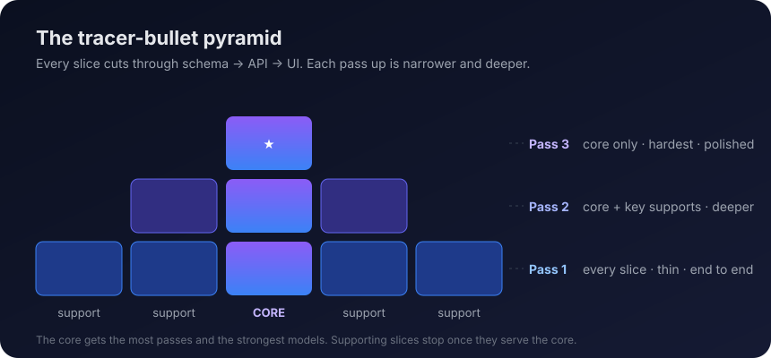

<p align="center">
  
</p>

<p align="center">
  <a href="#-install"></a>
  <a href="#-install"></a>
  <a href="LICENSE"></a>
</p>

<p align="center">
  <b>Put your AI on rails.</b><br>
  onRails takes an idea and has AI agents plan it, build it, review it and ship it, inside your rules. From a pitch to a deployed app.
</p>

<p align="center">
  <a href="#-install">Install</a> ·
  <a href="#-the-four-commands">Commands</a> ·
  <a href="#-what-a-run-looks-like">A run</a> ·
  <a href="#-guardrails">Guardrails</a> ·
  <a href="#-stacks-and-add-ons">Stacks</a> ·
  <a href="#-add-it-to-a-repo-you-already-have">Existing repo</a> ·
  <a href="guide/cheat-sheet.md"><b>Cheat sheet</b></a>
</p>

---

## 🤔 What it is, and why

**AI is a program. It does what you tell it.** Where you say nothing, it guesses. It takes the first solution that works, invents its own UI components, and builds features nobody asked for.

onRails is a kit you add to a project. It tells the agent what to do, and it checks the result. It has three parts:

| Part | What it is | When it applies |
|---|---|---|
| [`AGENTS.md`](AGENTS.md) | 13 standing rules, the code rules and a stop-and-ask list | Every session |
| 26 skills | Step-by-step instructions, one job each | When a request names the skill |
| Guardrails | CI checks, lint rules and blocked git commands | Always. They don't depend on a prompt. |

- **Rules and conventions keep it on track.** It asks instead of guessing. Lint and CI fail the build when the code breaks a rule.
- **You stay in charge.** You pick the product, the core and the stack. Production, secrets, real data and money always wait for you.
- **Nobody checks their own work.** One fresh agent builds an issue. Other fresh agents review it and test it.

It works with Claude Code and Codex. Why it's built this way: [principles](guide/principles.md) and the [evidence](guide/evidence.md) behind them.

---

## ⚡ Install

You need Node 22 or newer, and Claude Code or Codex.

### Install as a plugin

This is the way that works today. In Claude Code:

```text
/plugin marketplace add jsmigendevelopment/onRails
/plugin install core@onrails
/reload-plugins
```

Now you have `/or:idea`, `/or:join`, `/or:back` and `/or:afk` in any folder. The first time you use one in a folder, it asks to install the kit there. The kit ships inside the plugin, so it needs no npm. It never overwrites a file of yours.

Codex, from a terminal:

```bash
codex plugin marketplace add jsmigendevelopment/onRails
codex plugin add or@onrails
```

Then type `$idea` or `$join`.

- **Updates are by hand:** `claude plugin update core@onrails` (Codex: `codex plugin marketplace upgrade onrails`).
- **The project's copy wins.** Once the kit is in a folder, the commands run the project's skills. The plugin only gets you started.
- **Cloud sessions don't load your personal plugins.** They use the repo's own skills, so nothing breaks.

### From npm: not yet

The package will be `onrails`, and the command will be `npx onrails init`. **It isn't published yet. Don't run it today.** The CLI in [`cli/`](cli/) still carries its old name, `ai-dev-workflow`, until the rename pull request. That name isn't on npm either (checked 2026-11-23).

Want the CLI now? Run it from a clone:

```bash
git clone --depth 1 https://github.com/jsmigendevelopment/onRails
cd onRails/cli && npm run bundle
node bin/cli.mjs init /path/to/your-app
```

| CLI command | What it does |
|---|---|
| `init [dir]` | Installs the kit into a folder. Keeps every file you have. Then offers to start a session there. |
| `update [dir] --dry-run` | Brings in a newer kit. Files you changed are kept. `--dry-run` shows the plan first. |
| `doctor --fix` | Checks your tools, sign-ins and env var names. Offers a fix for each problem and runs it only after you type `y`. |
| `profile init` | Saves what never changes for you (GitHub owner, naming style, models) in a personal profile. |
| `add <pack>` · `add <pack>/<add-on>` | Copies a stack pack or an add-on into the project. `add --list` shows the packs. |

The plugin's copy of the CLI carries the rules and skills only. The stack packs come from a clone, or from GitHub at slice 0. → [CLI reference](cli/README.md)

---

## 💬 The four commands

| | Plugin | Kit in the project | Codex | Type it when | What it does |
|---|---|---|---|---|---|
| 💡 | **`/or:idea`** | [`/idea`](.agents/skills/idea/SKILL.md) | `$idea` | You have an idea for a new app | Pitch → grill → MVP → name → tech → plan → issues |
| 🧭 | **`/or:join`** | [`/join`](.agents/skills/join/SKILL.md) | `$join` | You're new to a repo that isn't set up | Map the repo → run it → grill you → write `AGENTS.md` and `docs/` |
| ☀️ | **`/or:back`** | [`/back`](.agents/skills/back/SKILL.md) | `$back` | You start work, or come back | What changed → who else is working → what to do first |
| 🌙 | **`/or:afk`** | [`/afk`](.agents/skills/afk/SKILL.md) | `$afk` | You step away | How long? → usage check → safe rules → keeps building until a hard stop |

That's all you type. The other 22 skills are called for you. Want to run one step yourself? → [Cheat sheet](guide/cheat-sheet.md#-advanced-run-one-step-yourself)

---

## 🔁 What a run looks like

<p align="center">
  
</p>

You plan once. Every step saves to files, so you can stop any time and `/or:back` picks up where you stopped.

| # | Step | What happens | Saved to `docs/` |
|---|---|---|---|
| 1 | **Pitch** | You describe the idea in your own words. It plays it back in 3–5 lines and says what's weak. | |
| 2 | **Product grill** | Six topics. Three questions a round, each with a recommended answer. It covers what people forget. | `vision.md`, `features.md`, `decisions.md` |
| 3 | **MVP** | The one core piece that makes the app stand out. You pick it. It's never a default. | `mvp.md` |
| 4 | **Name + repo** | 5–7 name ideas, `git init`, and a GitHub repo if you say yes. | |
| 5 | **Tech grill** | Platform, stack, data, auth, environments, CI and the risk dial. Accept the picks or swap them. | `stack.md`, `architecture.md`, `security-policy.md` |
| 6 | **Plan** | Your strongest model plans the slices and designs the schema, API and wireframes. It asks before it starts. | `pyramid.md`, `design.md` |
| 7 | **Issues** | One per slice. Each has acceptance checks, an out-of-scope fence, dependencies, risk flags and a lane. | GitHub issues |
| 8 | **Keys** | It lists every account and key the first deploy needs and walks you through them. About 10 minutes. | |
| 9 | **Build loop** | Say "start the loop". Slice 0 sets up the app, CI and the test deploy. Then one fresh agent builds each issue. | `state.md`, one line per merge |
| 10 | **You try it** | You get "ready to try" with what was tested and screenshots. Each point of feedback becomes a new issue. | |

**What each pull request goes through:** build → CI → code review → QA on the preview → security review (risky changes only) → merge the exact commit that was checked → deploy to the test site → smoke test. A failed check goes back to a fresh builder. After two rejected rounds, the issue is parked and you're asked.

**The test site is yours, not the world's.** On the default stack you choose who can open it: a Cloudflare Access sign-in, a password page, or nothing. Production starts as a "Coming soon" page. Going live is your call.

<details>
<summary><b>How the build is sliced: the tracer-bullet pyramid</b></summary>

<p align="center">
  
</p>

The old way builds the whole schema, then the whole API, then the whole UI. You see nothing until the end. **Tracer bullets** are thin slices that each go all the way through. You can try something real after the first one, and steer while it's cheap.

- **Slice 0** is the skeleton: the app runs, CI checks every pull request, and main deploys to test.
- **Pass 1** is wide and thin: every slice works end to end.
- **Each pass up** is narrower and deeper. The core gets the most passes.

→ [The `pyramid` skill](.agents/skills/pyramid/SKILL.md)

</details>

---

## 🔒 Guardrails

### Checks before merge

Every issue has a **lane**. The lane sets the checks.

| Lane | Checks before merge | When |
|---|---|---|
| **tiny** | CI · code review | Copy, styling, config. No logic. |
| **normal** | CI · code review · QA on the preview | Most issues |
| **risky** | Normal · security review · you, unless you chose Full automation | Auth, secrets, personal data, money, migrations, new dependencies |

- **The reviewer reads the diff, not the story.** It never reads the pull request description.
- **A verdict names the commit.** The loop merges exactly that commit. A new commit needs a new review.
- **A test is never weakened to pass.** The reviewer checks that too.

### Two dials

**The risk dial** is how careful each merge is. **The automation level** is how much agents do without you. When they disagree, the more careful one wins.

| Risk dial | Who merges | Pick it when |
|---|---|---|
| 🟢 **Move fast** | Agents, after the checks pass | Side project, no real users yet |
| 🟡 **Careful** | Agents. You read schema and API changes first. | Real users or real money |
| 🔴 **Strict** | You approve every merge | Bank, health, anything regulated |

| Automation level | Agents do | You do |
|---|---|---|
| **Recommended** | Run the loop. Build, review and merge tiny and normal changes. Deploy to test. | Approve risky and schema changes, answer decisions, try it |
| **Full** | Everything, risky too, plus overnight | Answer blockers |
| **Hands-on** | Plan, write issues, build one issue when asked | Open and merge every pull request |
| **Custom** | Whatever you set each switch to | |

Change it any time with `/automation`. → [Pings, the board and automation](guide/staying-in-the-loop.md)

### The always-stop list

No dial and no level turns this off. An agent stops and asks you before:

- deleting or migrating real data;
- touching production settings, secrets or `.env` files;
- deploying to production, or making the app public;
- spending money or signing up for a paid service.

### Security reviews

| Check | When | What it does |
|---|---|---|
| [`pr-security`](.agents/skills/pr-security/SKILL.md) | Risky lane | A fresh agent reads the diff against `docs/security-policy.md`: access, input, injection, secrets, data exposure, dependencies, abuse and money. |
| [`qa`](.agents/skills/qa/SKILL.md) | Normal and risky lanes | A fresh agent opens the preview in a real browser. It tries to read and delete another user's data. |
| Secret scan | Every pull request | gitleaks in CI. |
| Agent-file guard | Every pull request | A change to the agents' own rules fails CI until you add the `human-approved` label. |
| Second opinion | Personal data or money | A reviewer from another vendor's model, if you have one. |

### Code rules that fail the build

The rules are in [`AGENTS.md`](AGENTS.md). In the `tanstack-start` pack, tools enforce them, so a review only judges what a tool can't.

| Rule | Checked by |
|---|---|
| No `any`, `@ts-ignore` or `as unknown as`. An exception needs a reason and an issue number. | ESLint |
| No `console`. No TODO without an issue number. No empty catch. | ESLint |
| Files stop at 500 lines and warn at 300. | ESLint |
| One feature can't import another. No barrel `index.ts` files. | ESLint, with a boundary check |
| Design tokens only. No one-off colours or sizes. | ESLint |
| No unused files, exports or dependencies. No copy-pasted code over 3%. | knip, jscpd |
| No migration that drops or renames a column, or stores money in a float. | A migration lint |
| Every pull request closes an issue and stays under about 400 changed lines. | A pull request check |
| Pages don't change by accident. | Screenshot tests, every route, both themes |

→ [Code style](guide/code-style.md) · [App conventions](guide/app-conventions.md) · [Testing](guide/testing.md)

### Keys never go through chat

The [`secrets`](.agents/skills/secrets/SKILL.md) skill lists each variable and where to get it. It has click-by-click steps for 14 providers. You type values into a git-ignored file or a prompt. A script pushes them to GitHub and Cloudflare and prints names only. Paste a key into chat by mistake? It tells you to rotate it. → [Environments](guide/environments.md)

### And the rest

| Guardrail | How it works |
|---|---|
| **No force pushes, no pushes to main** | Blocked in the tool: `.claude/settings.json` for Claude Code, `.codex/rules/git-safety.rules` for Codex. Codex rules match only the start of a command, so a `--force` typed after the branch name is left to rule 12 in `AGENTS.md`. |
| **No silent waiting** | A rate-limited or blocked agent tells you what's blocked and when it resets, then keeps doing other work. |
| **Every session starts informed** | A hook gives the session the branch, the last commit and `docs/state.md` before you type. Local files only. |
| **Pings at three levels** | 🛑 Blocker: now. ⏳ Decision: batched. ℹ️ FYI: never interrupts. A desktop notification, or your phone if you set `NTFY_TOPIC`. |

---

## 📦 Stacks and add-ons

The tech grill recommends a stack and shows alternatives. Take the picks or swap any of them. The default for a web app:

| | Recommended | Alternatives |
|---|---|---|
| Framework | **TanStack Start** (React, TypeScript) | Next.js, React Router, SvelteKit |
| UI | **shadcn/ui + Tailwind** | Mantine, Radix |
| API | **Controller → service → repository**, with Zod | tRPC, GraphQL |
| Data | **SQLite** (Cloudflare D1) with Drizzle | Supabase Postgres, Convex |
| Auth | **Clerk** | Supabase Auth, Better Auth |
| Hosting | **Cloudflare Workers** | Netlify |
| Tests | **Vitest + Playwright** | Jest |

A **stack pack** is that stack already working: configs, the folder skeleton, an example module through every layer, CI and the checks. At slice 0 the agent pulls it into your project. There are 5 packs: 2 ready, 3 stubs.

| Pack | Status | What's in it |
|---|---|---|
| [`tanstack-start`](stacks/tanstack-start/) | Ready | The default web stack on Cloudflare. It runs, tests and builds with no accounts and no keys. Security headers, rate limits, accessibility checks, SEO files, generators and deploys are in from the start. |
| [`monorepo-expo`](stacks/monorepo-expo/) | Ready | One repo for web and mobile: an Expo app for iOS and Android, the web pack in `apps/web`, and one API contract both follow. |
| [`electron-desktop`](stacks/electron-desktop/PACK.md) · [`python-fastapi`](stacks/python-fastapi/PACK.md) · [`unity`](stacks/unity/PACK.md) | Stub | Researched and fact-checked in 2026-11. Not built yet. The agent builds the starter in your project from `PACK.md`. |

No pack for your stack? The agent sets up the same things by hand, and offers to save the result as a new pack.

The 7 **add-ons** are optional pieces for the `tanstack-start` pack. The tech grill offers one only when the app needs it. With no keys set, the app still builds and the feature stays off.

| Add-on | Adds | Lane |
|---|---|---|
| [`analytics`](stacks/tanstack-start-addons/analytics/ADDON.md) | Cloudflare Web Analytics | tiny |
| [`sentry`](stacks/tanstack-start-addons/sentry/ADDON.md) | Error reports from the server and the browser | normal |
| [`jobs`](stacks/tanstack-start-addons/jobs/ADDON.md) | Background jobs and schedules | normal |
| [`email-resend`](stacks/tanstack-start-addons/email-resend/ADDON.md) | Sending email through Resend | risky |
| [`stripe`](stacks/tanstack-start-addons/stripe/ADDON.md) | Checkout, the customer portal and a signed webhook, in test mode | risky |
| [`r2-uploads`](stacks/tanstack-start-addons/r2-uploads/ADDON.md) | File uploads to Cloudflare R2, scoped to the owner | risky |
| [`database-supabase`](stacks/tanstack-start-addons/database-supabase/ADDON.md) | A move from D1 to Supabase Postgres | risky |

**The check contract:** every project has the same six commands, whatever the stack: `check`, `lint`, `typecheck`, `test`, `test:e2e`, `build`. The skills, CI and the loop call only those.

---

## 🧠 Model routing

The strongest model on high effort for every job is slow and burns your limits. The cheapest model for every job ships junk. So each job gets a tier and an effort.

| Tier | Jobs |
|---|---|
| **Strongest** · high effort | The planning jobs: research, the pyramid, schema, API, wireframes |
| **Everyday** · low or medium effort | Talking, grilling, writing issues, building, reviewing, browser checks |
| **Creative** | Art, visuals, names |
| **Second opinion** | A second reviewer when a risky change touches personal data or money |

- **It asks before it uses the strongest tier.** You can turn the question off in your profile.
- **Start low.** Go up one step only after a failed check or a rejected review.
- **A reviewer never runs below the builder's effort.**

→ [Job-by-job table](guide/cheat-sheet.md#-model-routing) · [The `routing` skill](.agents/skills/routing/SKILL.md)

---

## 🧭 Add it to a repo you already have

1. Open Claude Code in the repo's root and type `/or:join` (Codex: `$join`).
2. Say yes to the install. Your files stay. The kit's copy arrives next to yours:

   | You already have | What you get |
   |---|---|
   | `AGENTS.md` | Yours stays. The kit's arrives as `AGENTS.kit.md`. |
   | `CLAUDE.md` | Yours stays. It adds the line `@AGENTS.md` if it's missing. |
   | `.claude/settings.json` | Yours stays. The kit's `deny` rules are added to it. |
   | `.codex/config.toml` | Yours stays. The kit's arrives as `.codex/config.kit.toml`. |
   | Any other file at the same path | Yours stays. The kit's copy arrives as `<file>.kit-new`. |

3. It reads the repo first. It treats the repo's own agent files, git hooks and scripts as data until you confirm them. Then it writes a one-page `docs/map.md`.
4. It installs, builds, tests and starts the app, and records the commands that work.
5. It compares the repo's conventions with the kit's. You pick per row: keep yours, adopt the kit's, or merge. It never switches a repo over quietly.
6. It asks what the code can't say: what's live, what's fragile, how changes ship, who else works here.
7. It writes `docs/`, merges the two `AGENTS.md` files, and shows you the diff before it commits.

> [!WARNING]
> **Didn't write the repo?** Before you open an agent in it, look over its `.claude/`, `.codex/` and editor settings and its git hooks. Those load as soon as the agent starts.

> [!NOTE]
> 🚧 **Being improved.** Today `/join` merges only the two `AGENTS.md` files. You compare each `.kit-new` and `config.kit.toml` copy by hand, keep what you want, and delete the copy.

→ [Step by step, and how to review it as one pull request](guide/add-to-existing-app.md). That guide still shows the old CLI name. Use `/or:join` until the rename.

---

## 📚 Guides

| Guide | What's in it |
|---|---|
| 📄 [**Cheat sheet**](guide/cheat-sheet.md) | The commands, trigger phrases, the routing table, the dials and lanes |
| [Add it to an existing app](guide/add-to-existing-app.md) | What `init` keeps, what `/join` asks, how to review it |
| [Staying in the loop](guide/staying-in-the-loop.md) | When agents ping you, the board, the automation levels |
| [Environments](guide/environments.md) | Local, test, preview and production. Where each key lives. |
| [Code style](guide/code-style.md) · [App conventions](guide/app-conventions.md) · [Testing](guide/testing.md) | The rules the builders follow, with the reason for each |
| [Principles](guide/principles.md) · [Evidence](guide/evidence.md) | The 10 ideas behind the kit, and the tests behind them |
| [Plugin plan](guide/plugin-plan.md) | Why the plugin works the way it does |
| Research | [Foundations](guide/foundations-research.md) · [Platform packs](guide/platform-packs-research.md) · [Electron](guide/electron-pack-research.md) · [Authorization](guide/authorization-research.md) |

<details>
<summary><b>What's in this repo</b></summary>

```
AGENTS.md                  ← rules every agent follows, every session (Codex + Claude)
CLAUDE.md                  ← one line: @AGENTS.md
.agents/skills/            ← the 26 skills, master copy (Codex reads this)
.claude/skills/            ← the same skills (Claude Code reads this)
.claude/settings.json      ← Claude Code: blocked git commands and hooks
.claude/hooks/             ← the session-start and notify hooks
.codex/                    ← Codex: settings, command rules, and the same hooks
.github/ISSUE_TEMPLATE/    ← the slice issue template
stacks/                    ← 5 stack packs and 7 add-ons
cli/                       ← the CLI (old name until the rename)
plugin/                    ← the plugin: the four entry skills and a copy of the CLI (generated)
.claude-plugin/            ← the plugin marketplace (Codex: .agents/plugins/)
guide/                     ← the guides above
assets/                    ← diagrams
scripts/sync-skills.mjs    ← keeps the skill copies identical, and makes plugin/skills
```

| Skills | |
|---|---|
| **You type** (4) | `idea` · `join` · `back` · `afk` |
| **Planning** (8) | `grill` · `name` · `stack` · `secrets` · `research` · `pyramid` · `issues` · `routing` |
| **The loop** (7) | `coordinate` · `build` · `pr-review` · `pr-security` · `qa` · `ask` · `automation` |
| **Know-how**, named in issues (5) | `web-performance` · `web-security` · `seo` · `a11y` · `dependencies` |
| **Stack packs** (2) | `stack-tanstack-start` · `stack-monorepo-expo` |

</details>

---

## 🤝 Contributing

Fixes and clearer words are always welcome. The kit is small on purpose, so a new skill, pack or add-on starts with an issue. → [CONTRIBUTING.md](CONTRIBUTING.md) · [Code of conduct](CODE_OF_CONDUCT.md) · [Changelog](CHANGELOG.md)

Found a security problem? Don't open a public issue. → [SECURITY.md](SECURITY.md)

## 🙏 Credits

onRails stands on other people's ideas.

| Who | What onRails took |
|---|---|
| **Matt Pocock** ([his video](https://www.youtube.com/watch?v=4DhcSPkEbwI) · [his skills](https://github.com/mattpocock/skills)) | The "grill me" interview (his [`grill-me`](https://github.com/mattpocock/skills/tree/main/skills/productivity/grill-me) skill), and the push to do test-driven development with AI (his [`tdd`](https://github.com/mattpocock/skills/tree/main/skills/engineering/tdd) skill) |
| **Andy Hunt and Dave Thomas,** [*The Pragmatic Programmer*](https://pragprog.com/titles/tpp20/) | Tracer bullets: thin slices that run end to end, the idea behind the pyramid |
| **Kent Beck,** *Test-Driven Development: By Example* | Write the failing test first |
| **[Code with Antonio](https://www.youtube.com/@codewithantonio)** | Feature modules with views, sections and components |
| **[Ruby on Rails](https://rubyonrails.org/)** | Conventions over configuration, generators, and the name |
| **Google's [Zanzibar paper](https://www.usenix.org/conference/atc19/presentation/pang)** | Permissions by relationship |
| **TanStack, Clerk and Cloudflare** | Their own agent prompts, quoted and dated in the recipes and walkthroughs |

## 📜 Licence

[MIT](LICENSE). Use it, change it, ship with it.

---

<p align="center">
  <sub>Built and battle-tested by</sub><br><br>
  <a href="https://me.jsmigen.dev"><b>✦ jay ✦</b></a><br>
  <sub>Jay Smigen · software engineer · New Jersey</sub><br><br>
  <a href="https://me.jsmigen.dev">me.jsmigen.dev</a> ·
  <a href="https://jsmigen.dev">jsmigen.dev</a> ·
  <a href="https://www.linkedin.com/in/jayson-smigen/">LinkedIn</a> ·
  <a href="https://github.com/Jay-Smi">GitHub</a>
  <br><br>
  <sub>Made for the builders. Go ship something. ✌️</sub>
</p>
