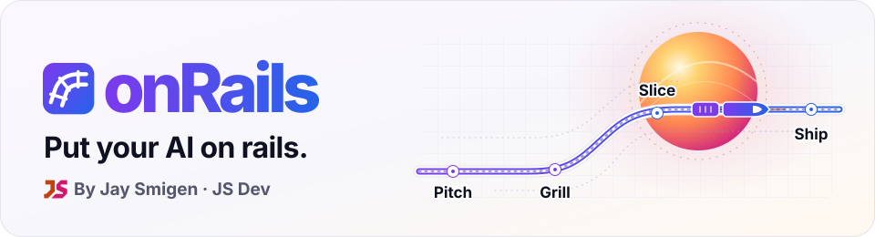
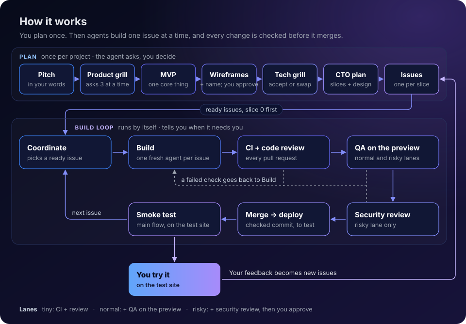
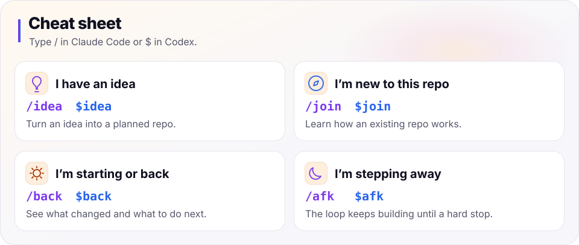

<picture>
  <source media="(prefers-color-scheme: dark)" srcset="assets/banner-dark.svg">
  
</picture>

**onRails** helps AI agents plan, build, review and ship your app within rules you set.

## ⚡ Install

Use Node 22 or newer with Claude Code or Codex. Run these two commands in a terminal to install for your Claude Code account.

```bash
claude plugin marketplace add jsmigendevelopment/onRails
claude plugin install core@onrails --scope user
```

Start a new Claude Code session. For other setups, see [Codex](#codex) or [npm](#from-npm).

## 💬 The four commands

| Claude Code · Codex | When to use it | What happens |
|---|---|---|
| [`/idea`](.agents/skills/idea/SKILL.md) · `$idea` | Start a new app | Plan from pitch to issues. You approve the screens before tech work. |
| [`/join`](.agents/skills/join/SKILL.md) · `$join` | Set up an existing repo | Map and run the repo, ask questions, then write `AGENTS.md` and `docs/`. |
| [`/back`](.agents/skills/back/SKILL.md) · `$back` | Start or resume work | See what changed, who's working and what to do first. |
| [`/afk`](.agents/skills/afk/SKILL.md) · `$afk` | Step away | Set a time, check usage and safety, then keep building until a hard stop. |

The other 25 skills run for you. To run one step yourself, see the [cheat sheet](guide/cheat-sheet.md#-advanced-run-one-step-yourself).

[](https://www.npmjs.com/package/onrails)
[](#-install)
[](#codex)
[](LICENSE)

[Install](#-install) · [Commands](#-the-four-commands) · [A run](#-what-a-run-looks-like) · [Guardrails](#-guardrails) · [Stacks](#-stacks-and-add-ons) · [Existing repo](#-add-it-to-a-repo-you-already-have) · [Cheat sheet](guide/cheat-sheet.md)

## More install options

### Install as a plugin

In Claude Code, check the account install with `claude plugin list`. Look for `core@onrails` at `user` scope.

Already in Claude Code? Run `/plugin marketplace add jsmigendevelopment/onRails`, then `/plugin install core@onrails`. Pick **user** when it asks for a scope, then run `/reload-plugins`. User scope works in any folder. Project and local scope work in that folder only.

The first time you use a command in a folder, it asks to install the kit there. The plugin includes the kit and keeps your files. If another plugin or command uses the same name, use the prefix, as in `/or:idea`.

### Codex

Run these two commands in a terminal:

```bash
codex plugin marketplace add jsmigendevelopment/onRails
codex plugin add or@onrails
```

Then type `$idea` or `$join`.

- **Update the plugin by hand.** Run `claude plugin marketplace update onrails`, then `claude plugin update core@onrails`. In Codex, run `codex plugin marketplace upgrade onrails`.
- **Marketplace 'onrails' not found?** The marketplace was added in a project. Run both install commands again for your account.
- **The project's copy wins.** Once you install the kit in a folder, commands use that project's skills. Cloud sessions also use the repo's skills since they don't load personal plugins.
- **The plugin works without npm.** Its CLI includes the rules and skills. Stack packs come from a clone or from GitHub at slice 0.

### From npm

Run this in your project folder:

```bash
npx onrails init
```

It installs the rules and skills, keeps your files and offers to open Claude Code or Codex with `/idea` (or `/join` if the folder already has code).

| CLI command | What it does |
|---|---|
| `init [dir]` | Installs the kit, keeps your files and offers to start a session there. |
| `update [dir] --dry-run` | Updates the kit and keeps files you changed. `--dry-run` shows the plan first. |
| `doctor --fix` | Checks tools, sign-ins and env var names. Runs each offered fix after you type `y`. |
| `profile init` | Saves things like your GitHub owner, naming style and models in your profile. |
| `add <pack>` · `add <pack>/<add-on>` | Copies a stack pack or add-on into your project. `add --list` shows the packs. |

[CLI reference](cli/README.md) · [Release steps for maintainers](RELEASING.md)

## 🤔 What it is, and why

AI agents follow your instructions. Where you leave a gap, they guess. They can take the first fix that works, invent UI components or build extra features. Add onRails to your project to set the rules and check its work.

| Part | What it is | When it applies |
|---|---|---|
| [`AGENTS.md`](AGENTS.md) | 13 standing rules, the code rules and a stop-and-ask list | Every session |
| 29 skills | Step-by-step instructions, one job each | When a request names the skill |
| Guardrails | CI checks, lint rules and blocked git commands | Always. They don't depend on a prompt. |

- **Rules and conventions keep it on track.** It asks instead of guessing. Lint and CI fail the build when the code breaks a rule.
- **You stay in charge.** You pick the product, the core and the stack. Production, secrets, real data and money always wait for you.
- **Nobody checks their own work.** One fresh agent builds an issue. Other fresh agents review it and test it.

See the [principles](guide/principles.md) and [evidence](guide/evidence.md) behind the kit.

## 🔁 What a run looks like

<picture>
  <source media="(prefers-color-scheme: dark)" srcset="assets/how-it-works-dark.svg">
  
</picture>

Plan once. Each step saves to files, so you can stop any time and pick up with `/back`.

| # | Step | What happens | Saved to `docs/` |
|---|---|---|---|
| 1 | **Pitch** | You describe the idea in your own words. The agent repeats it in 3 to 5 lines and points out weak spots. | |
| 2 | **Product grill** | Seven topics cover things people miss. Each round has three questions with suggested answers. Once the main flow is clear, your everyday model draws rough wireframes in the background. You describe the look, then the agent asks to use your strongest model for the full design. You see each screen as it's done. | `vision.md`, `features.md`, `decisions.md`, `wireframes/index.html`, `design.md` |
| 3 | **MVP** | You pick the one thing that makes the app stand out. | `mvp.md` |
| 4 | **Name** | While the screens finish, you get 5 to 7 names, `git init` and a GitHub repo if you say yes. | |
| 5 | **You approve the screens** | Try the full set as a clickable light and dark prototype. The agent asks what to change and starts tech work after you approve. | `decisions.md` |
| 6 | **Tech grill** | Platform, stack, data, auth, environments, CI and the risk dial. Accept the picks or swap them. | `stack.md`, `architecture.md`, `security-policy.md` |
| 7 | **Plan** | After you approve the strongest model, it outlines three passes, cuts the first into steps you can try, and designs the schema and API from the approved screens. A script checks the steps. | `pyramid.md`, `design.md` |
| 8 | **Issues** | One per step in the current pass. Each says what to try, gives WHEN/THEN checks with IDs, and lists scope limits, dependencies, risks, a lane and a complexity score. A read-only check looks for gaps in the plan. | GitHub issues |
| 9 | **Keys** | It lists the accounts and keys for the first deploy and helps you set them up in about 10 minutes. | |
| 10 | **Build loop** | Say "start the loop". Slice 0 sets up the app, CI and the test deploy. Then one fresh agent builds each issue, three in flight at most (one on Hands-on). | `state.md`, a line on what to try per merge |
| 11 | **Pass gate** | The loop keeps going. A fresh audit checks the code against the plan and screens. The loop fixes what it finds and does some cleanup. Try it when you can, then the agent plans the next pass. | `pyramid.md` |

**What each pull request goes through:** build → CI → code review → QA on the preview → security review (risky changes only) → merge the exact commit that was checked → deploy to the test site → smoke test. A failed check goes back to a fresh builder. After two rejected rounds, the issue is parked and you're asked.

**You control the test site.** The default stack lets you use Cloudflare Access, a password page or open access. Production starts on a “Coming soon” page. You decide when to go live.

### How the build is sliced: the tracer-bullet pyramid

<picture>
  <source media="(prefers-color-scheme: dark)" srcset="assets/tracer-bullet-pyramid-dark.svg">
  
</picture>

If you build the full schema, then the API, then the UI, there’s nothing to try until the end. **Tracer bullets** cut through all three in thin slices. Try the first slice and steer while changes are cheap.

- **Slice 0** is the skeleton: the app runs, CI checks every pull request, and main deploys to test.
- **The MVP is three passes:** Works (a thin tracer bullet through every slice), Real (the core goes deep), Ready (the core polished, plus speed, accessibility, SEO and the launch checklist).
- **A pass is an improvement** to what's already there.
- **Each pass is cut into thin steps.** A slice is one thing the app lets you do, like "the shared list". A step is the smallest change to it that you can try, like "add an item". One step is one issue and one pull request, so every merge puts something new on the test site to try.
- **Only what the core can't work without** goes in the MVP. Everything else comes after.
- **A gate between passes:** a fresh audit and cleanup, which start at once, then you try it, then a re-plan. Later passes stay an outline until then.
- **The end of pass 3 is "MVP complete" on the test site, not launch.** Going live is your call, whenever you choose.
- **After the MVP, an hourglass:** the shape turns upside down and widens. Each layer adds new features, each in thin, plus a pass on what's already there, the core every time. Same gate between layers.

**In agile terms**, a step is a user story sliced vertically. A slice is the activity its stories belong to. A pass or a layer is an iteration. The gate is the review, the retro and backlog refinement in one. `features.md` is the backlog. "Done means" in `pyramid.md` is the definition of done. Three in flight is the work-in-progress limit. The kit makes agents follow these rules. [The research behind it](research/agile-flow.md)

→ [The `pyramid` skill](.agents/skills/pyramid/SKILL.md)

## 🔒 Guardrails

### Checks before merge

Every issue has a **lane**. The lane sets the checks.

| Lane | Checks before merge | When |
|---|---|---|
| **tiny** | CI · code review | Copy, styling, config. No logic. |
| **normal** | CI · code review · QA on the preview | Most issues |
| **risky** | Normal · security review · you, unless you chose Full automation | Auth, secrets, personal data, money, migrations, new dependencies |

- **The reviewer reads the diff.** It skips the pull request description.
- **The review names the commit to merge.** A new commit needs a new review.
- **A test is never weakened to pass.** The reviewer checks that too.

### Two dials

**The risk dial** is how careful each merge is. **The automation level** is how much agents do without you. When they disagree, the more careful one wins.

| Risk dial | Who merges | Pick it when |
|---|---|---|
| 🟢 **Move fast** | Agents, after the checks pass | Side project, no real users yet |
| 🟡 **Careful** | Agents. You read schema and API changes first. | Real users or real money |
| 🔴 **Strict** | You approve every merge | Bank, health, anything regulated |

| Automation level | Agents do | You do |
|---|---|---|
| **Recommended** | Run the loop. Build, review and merge tiny and normal changes. Deploy to test. | Approve risky and schema changes, answer decisions, try it |
| **Full** | Everything, risky too, plus overnight | Answer blockers |
| **Hands-on** | Plan, write issues, build one issue when asked | Open and merge every pull request |
| **Custom** | Whatever you set each switch to | |

Change it any time with `/automation`. → [Pings, the board and automation](guide/staying-in-the-loop.md)

### The always-stop list

At every risk and automation level, the agent stops and asks before:

- deleting or migrating real data
- touching production settings, secrets or `.env` files
- deploying to production or making the app public
- spending money or signing up for a paid service

### Security reviews

| Check | When | What it does |
|---|---|---|
| [`pr-security`](.agents/skills/pr-security/SKILL.md) | Risky lane | A fresh agent reads the diff against `docs/security-policy.md`: access, input, injection, secrets, data exposure, dependencies, abuse and money. |
| [`qa`](.agents/skills/qa/SKILL.md) | Normal and risky lanes | A fresh agent opens the preview in a real browser. It tries to read and delete another user's data. |
| Secret scan | Every pull request | gitleaks in CI. |
| Agent-file guard | Every pull request | A change to the agents' own rules fails CI until you add the `human-approved` label. |
| Second opinion | Personal data or money | A reviewer from another vendor's model, if you have one. |

### Code rules that fail the build

The rules are in [`AGENTS.md`](AGENTS.md). In the `tanstack-start` pack, tools enforce them, so a review only judges what a tool can't.

| Rule | Checked by |
|---|---|
| No `any`, `@ts-ignore` or `as unknown as`. An exception needs a reason and an issue number. | ESLint |
| No `console`. No TODO without an issue number. No empty catch. | ESLint |
| Files stop at 500 lines and warn at 300. | ESLint |
| One feature can't import another. No barrel `index.ts` files. | ESLint, with a boundary check |
| Design tokens only. No one-off colours or sizes. | ESLint |
| No unused files, exports or dependencies. No copy-pasted code over 3%. | knip, jscpd |
| No migration that drops or renames a column, or stores money in a float. | A migration lint |
| Every pull request closes an issue and stays under about 400 changed lines. | A pull request check |
| Pages don't change by accident. | Screenshot tests, every route, both themes |

→ [Code style](guide/code-style.md) · [App conventions](guide/app-conventions.md) · [Testing](guide/testing.md)

### Keys never go through chat

The [`secrets`](.agents/skills/secrets/SKILL.md) skill lists each variable and where to get it. It has click-by-click steps for 14 providers. You type values into a git-ignored file or a prompt. A script pushes them to GitHub and Cloudflare and prints names only. Paste a key into chat by mistake? It tells you to rotate it. → [Environments](guide/environments.md)

### Tests that the skills change behaviour

[`evals/`](evals/README.md) holds nine small scenarios, one per rule that matters most: the grill asks before it builds, no force push or push to main, keys never in chat or git, test first inside the fence, a reviewer catches a weakened test, the wireframe gate, asking before the strongest model, a plan cut into thin steps you can try, and a plan cut by layer sent back. Each runs in Claude Code twice, with the kit and without, and checks what the agent did from its transcript and files, never from another model's opinion. A scenario passes only if the kit made the difference. CI runs them on Claude Haiku 5.5 when a skill, `AGENTS.md`, the plugin or a script changes. A full run cost about $0.16 when measured in 2026-11. Not every scenario passes on that model yet: [the evals README](evals/README.md#cost-controls) says which. `npm run evals` runs them locally with your own login.

### And the rest

| Guardrail | How it works |
|---|---|
| **No force pushes, no pushes to main** | Blocked in the tool: `.claude/settings.json` for Claude Code, `.codex/rules/git-safety.rules` for Codex. Codex rules match only the start of a command, so a `--force` typed after the branch name is left to rule 12 in `AGENTS.md`. |
| **No silent waiting** | A rate-limited or blocked agent tells you what's blocked and when it resets, then keeps doing other work. |
| **A few things at a time** | The loop keeps three issues in flight (one on Hands-on), counting claimed work that waits on you, and finishes one before it starts another. `flow.mjs` prints how many merged, how long one took and the longest gap with no merge. |
| **Every session starts informed** | A hook gives the session the branch, the last commit and `docs/state.md` before you type. Local files only. |
| **Pings at three levels** | 🛑 Blocker: now. ⏳ Decision: batched. ℹ️ FYI: never interrupts. A desktop notification, or your phone if you set `NTFY_TOPIC`. |

## 📦 Stacks and add-ons

The tech grill recommends a stack and shows the options for each part. Keep its picks or swap them. These are the web app defaults.

| Part | Recommended | Or |
|---|---|---|
| Framework | **TanStack Start** (React, TypeScript) | Next.js, React Router, SvelteKit |
| Look and feel | **shadcn/ui** components + **Tailwind** | Mantine, Radix |
| Database | **SQLite** on Cloudflare D1, queried with **Drizzle** | Supabase Postgres, Convex |
| Sign-in | **Clerk** | Supabase Auth, Better Auth |
| Hosting | **Cloudflare Workers** | Netlify |
| Tests | **Vitest** for units, **Playwright** in a real browser | Jest |

**How the server side talks to the app:**
- **The web app** calls typed server functions, so there's no API layer to write by hand.
- **Phones and other clients** get a versioned HTTP API at `/api/v1`, signed in with Clerk tokens.
- **Every input** is checked with Zod schemas, on both paths.

**When a feature needs it, the defaults are TanStack libraries:**
- Query for server data;
- Form;
- Table;
- Charts;
- Markdown;
- Highlight for code;
- Virtual for long lists;
- Hotkeys.

Each one comes with a recipe. Nothing is installed until a feature needs it.

**How the code is laid out:** one folder per feature. A request goes route → service → database, and features can't reach into each other. That's a rule lint enforces, not a stack choice. See [Guardrails](#-guardrails).

A **stack pack** is that stack already working: configs, the folder skeleton, an example module through every layer, CI and the checks. At slice 0 the agent pulls it into your project. There are 5 packs: 2 ready, 3 stubs.

| Pack | Status | What's in it |
|---|---|---|
| [`tanstack-start`](stacks/tanstack-start/) | Ready | The default web stack on Cloudflare. It runs, tests and builds with no accounts and no keys. Security headers, rate limits, accessibility checks, SEO files, generators and deploys are in from the start. |
| [`monorepo-expo`](stacks/monorepo-expo/) | Ready | One repo for web and mobile: an Expo app for iOS and Android, the web pack in `apps/web`, and one API contract both follow. |
| [`electron-desktop`](stacks/electron-desktop/PACK.md) · [`python-fastapi`](stacks/python-fastapi/PACK.md) · [`unity`](stacks/unity/PACK.md) | Stub | Researched and fact-checked in 2026-11. Not built yet. The agent builds the starter in your project from `PACK.md`. |

No pack for your stack? The agent sets up the same things by hand, and offers to save the result as a new pack.

The `tanstack-start` pack has 7 optional **add-ons**. The tech grill offers them as needed. Without keys, the app still builds and the add-on stays off.

| Add-on | Adds | Lane |
|---|---|---|
| [`analytics`](stacks/tanstack-start-addons/analytics/ADDON.md) | Cloudflare Web Analytics | tiny |
| [`sentry`](stacks/tanstack-start-addons/sentry/ADDON.md) | Error reports from the server and the browser | normal |
| [`jobs`](stacks/tanstack-start-addons/jobs/ADDON.md) | Background jobs and schedules | normal |
| [`email-resend`](stacks/tanstack-start-addons/email-resend/ADDON.md) | Sending email through Resend | risky |
| [`stripe`](stacks/tanstack-start-addons/stripe/ADDON.md) | Checkout, the customer portal and a signed webhook, in test mode | risky |
| [`r2-uploads`](stacks/tanstack-start-addons/r2-uploads/ADDON.md) | File uploads to Cloudflare R2, scoped to the owner | risky |
| [`database-supabase`](stacks/tanstack-start-addons/database-supabase/ADDON.md) | A move from D1 to Supabase Postgres | risky |

**The check contract:** every project has the same six commands, whatever the stack: `check`, `lint`, `typecheck`, `test`, `test:e2e`, `build`. The skills, CI and the loop call only those.

## 🧠 Model routing

The strongest model at high effort takes more time and usage. The cheapest model can miss things. onRails picks a **model tier** and an **effort level** for each job.

| Job | Tier · effort | Example model |
|---|---|---|
| The thread you talk to all day (the loop) | Everyday · low | Claude Opus 5.5 |
| Grill and planning chat | Everyday · medium | Claude Opus 5.5 |
| Wireframes, stage 1: grey-box layout | Everyday · medium | Claude Opus 5.5 |
| **CTO work:** research, the pyramid, schema, API design, wireframes stage 2 (the detailed design) | **Strongest · high** | Claude Fable 5.2 |
| Writing issues from the plan | Everyday · medium | Claude Opus 5.5 |
| Building an issue | Everyday · low at complexity 1–4, medium at 5–7 or from pass 2 | Claude Opus 5.5 |
| Code review | Everyday · never below the builder | Claude Opus 5.5 |
| Security review (risky changes only) | Everyday · one step above review | Claude Opus 5.5, plus a second vendor's model when it touches personal data or money |
| Browser checks | Everyday · low | Claude Opus 5.5 |
| Art, visuals, names | Creative | ChatGPT |

<sub>The example models were checked in 2026-11. Pick your own models for each tier.</sub>

- **It asks before it uses the strongest tier.** You can turn the question off in your profile.
- **Start low.** Go up one step only after a failed check or a rejected review.
- **A reviewer never runs below the builder's effort.**

**Accounts.** More than one Claude or Codex account, like a work one and a personal one? `/idea` and `/join` ask once, walk you through signing each in with its own config folder (`CLAUDE_CONFIG_DIR` or `CODEX_HOME`), and write `[accounts]` in your profile. **It's a fixed split by job or project that you set, never by usage.** onRails never spreads, balances or moves work between accounts to get past a limit. At a limit, that account's work waits for its reset, and the session tells you the reset time. Why: providers' terms can treat moving work as account rotation, and it puts your accounts at risk. A job for another account gets a ready-to-paste prompt for that account's session. Unattended work starts in a cloud session first (`[sessions] prefer = "cloud"`). `npx onrails accounts` lists them.

→ [Job-by-job table](guide/cheat-sheet.md#-model-routing) · [The `routing` skill](.agents/skills/routing/SKILL.md)

## 🧭 Add it to a repo you already have

1. Open Claude Code in the repo's root and type `/join` (Codex: `$join`).
2. Say yes to the install. Your files stay. The kit's copy arrives next to yours:

   | You already have | What you get |
   |---|---|
   | `AGENTS.md` | Yours stays. The kit's arrives as `AGENTS.onrails.md`. |
   | `CLAUDE.md` | Yours stays. It adds the line `@AGENTS.md` if it's missing. |
   | `.claude/settings.json` | Yours stays. The kit's `deny` rules are added to it. |
   | `.codex/config.toml` | Yours stays. The kit's arrives as `.codex/config.onrails.toml`. |
   | Any other file at the same path | Yours stays. The kit's copy arrives as `<file>.onrails-new`. |

3. It reads the repo first. It treats the repo's own agent files, git hooks and scripts as data until you confirm them. Then it writes a one-page `docs/map.md`.
4. It installs, builds, tests and starts the app, and records the commands that work.
5. It compares the repo's conventions with the kit's. You pick per row: keep yours, adopt the kit's, or merge. It never switches a repo over quietly.
6. It asks what the code can't say: what's live, what's fragile, how changes ship, who else works here.
7. It writes `docs/`, merges the two `AGENTS.md` files, and shows you the diff before it commits.

> [!WARNING]
> **Didn't write the repo?** Before you open an agent in it, look over its `.claude/`, `.codex/` and editor settings and its git hooks. Those load as soon as the agent starts.

> [!NOTE]
> 🚧 **Being improved.** Today `/join` merges only the two `AGENTS.md` files. You compare each `.onrails-new` and `config.onrails.toml` copy by hand, keep what you want, and delete the copy.

→ [Step by step, and how to review it as one pull request](guide/add-to-existing-app.md). Use `/join`, or run `npx onrails init` in the repo first.

## 📚 Guides

<picture>
  <source media="(prefers-color-scheme: dark)" srcset="assets/cheat-sheet-dark.svg">
  
</picture>

| Guide | What's in it |
|---|---|
| 📄 [**Cheat sheet**](guide/cheat-sheet.md) | The commands, trigger phrases, the routing table, the dials and lanes |
| [Add it to an existing app](guide/add-to-existing-app.md) | What `init` keeps, what `/join` asks, how to review it |
| [Staying in the loop](guide/staying-in-the-loop.md) | When agents ping you, the board, the automation levels |
| [Environments](guide/environments.md) | Local, test, preview and production. Where each key lives. |
| [Code style](guide/code-style.md) · [App conventions](guide/app-conventions.md) · [Testing](guide/testing.md) | The rules the builders follow, with the reason for each |
| [Principles](guide/principles.md) · [Evidence](guide/evidence.md) | The 10 ideas behind the kit, and the tests behind them |
| [Plugin plan](research/plugin-plan.md) | Why the plugin works the way it does |
| [Research](research/README.md) | [Foundations](research/foundations.md) · [Platform packs](research/platform-packs.md) · [Electron](research/electron-pack.md) · [Authorization](research/authorization.md) · [Agile flow](research/agile-flow.md) |

### What’s in this repo

```
AGENTS.md                  ← rules every agent follows, every session (Codex + Claude)
CLAUDE.md                  ← one line: @AGENTS.md
.agents/skills/            ← the 29 skills, master copy (Codex reads this)
.claude/skills/            ← the same skills (Claude Code reads this)
.claude/settings.json      ← Claude Code: blocked git commands and hooks
.claude/hooks/             ← the session-start and notify hooks
.codex/                    ← Codex: settings, command rules, and the same hooks
.github/ISSUE_TEMPLATE/    ← the slice issue template
stacks/                    ← 5 stack packs and 7 add-ons
cli/                       ← the onrails CLI
plugin/                    ← the plugin: the four entry skills and a copy of the CLI (generated)
.claude-plugin/            ← the plugin marketplace (Codex: .agents/plugins/)
guide/                     ← the guides above
research/                  ← the research and plans behind the kit (never copied into a project), indexed with provenance
assets/                    ← diagrams
scripts/sync-skills.mjs    ← keeps the skill copies identical, and makes plugin/skills
scripts/check-research.mjs ← checks a research folder: index, provenance, labels, re-check dates (ships in the research skill)
```

| Skills | |
|---|---|
| **You type** (4) | `idea` · `join` · `back` · `afk` |
| **Planning** (9) | `grill` · `wireframes` · `name` · `stack` · `secrets` · `research` · `pyramid` · `issues` · `routing` |
| **The loop** (8) | `coordinate` · `build` · `diagnose` · `pr-review` · `pr-security` · `qa` · `ask` · `automation` |
| **Know-how**, named in issues (6) | `web-performance` · `web-security` · `seo` · `a11y` · `dependencies` · `writing-for-agents` |
| **Stack packs** (2) | `stack-tanstack-start` · `stack-monorepo-expo` |

## 🤝 Contributing

Fixes and clearer words are welcome. To keep the kit small, start with an issue for a new skill, pack or add-on. [CONTRIBUTING.md](CONTRIBUTING.md) · [Code of conduct](CODE_OF_CONDUCT.md) · [Changelog](CHANGELOG.md)

Report security problems privately. [SECURITY.md](SECURITY.md)

## 🙏 Credits

| Who | What onRails took |
|---|---|
| **Matt Pocock** ([his video](https://www.youtube.com/watch?v=4DhcSPkEbwI) · [his skills](https://github.com/mattpocock/skills)) | The "grill me" interview (his [`grill-me`](https://github.com/mattpocock/skills/tree/main/skills/productivity/grill-me) skill), the push to do test-driven development with AI (his [`tdd`](https://github.com/mattpocock/skills/tree/main/skills/engineering/tdd) skill), and the skills adapted from his: `diagnose` (from [`diagnosing-bugs`](https://github.com/mattpocock/skills/tree/main/skills/engineering/diagnosing-bugs)), the red, green, refactor loop in `build`, the retro in `/back` and `/afk` (from [`retro`](https://github.com/mattpocock/skills/tree/main/skills/engineering/retro)) and `writing-for-agents` (from [`writing-for-agents`](https://github.com/mattpocock/skills/tree/main/skills/productivity/writing-for-agents)). MIT, see [NOTICE](NOTICE) |
| **Andy Hunt and Dave Thomas,** [*The Pragmatic Programmer*](https://pragprog.com/titles/tpp20/) | Tracer bullets: thin slices that run end to end, the idea behind the pyramid |
| **Kent Beck,** *Test-Driven Development: By Example* | Write the failing test first |
| **[Code with Antonio](https://www.youtube.com/@codewithantonio)** | Feature modules with views, sections and components |
| **[Ruby on Rails](https://rubyonrails.org/)** | Conventions over configuration, generators, and the name |
| **Google's [Zanzibar paper](https://www.usenix.org/conference/atc19/presentation/pang)** | Permissions by relationship |
| **TanStack, Clerk and Cloudflare** | Their own agent prompts, quoted and dated in the recipes and walkthroughs |

## 📜 Licence

[MIT](LICENSE). Use it, change it, ship with it.

---

<!-- onrails:signature start -->
<p align="center">
  <a href="https://jsmigen.dev">
    
  </a><br>
  Built by <a href="https://jsmigen.dev"><b>Jay Smigen</b></a><br>
  <sub>JS Dev · Full-stack software engineer</sub><br><br>
  <a href="https://jsmigen.dev">JS Dev</a> ·
  <a href="https://me.jsmigen.dev">Portfolio</a> ·
  <a href="https://jsmigen.dev/blog/">Build Log</a> ·
  <a href="https://www.linkedin.com/in/jayson-smigen/">LinkedIn</a> ·
  <a href="https://github.com/jsmigendevelopment">GitHub</a>
  <br><br>
  <sub>Build it right. Ship it.</sub>
</p>
<!-- onrails:signature end sha256=60f1ea1f381e9b6d2458a0cc4cd15e943393915d1873455b8d009d0cf06cc8c8 -->
