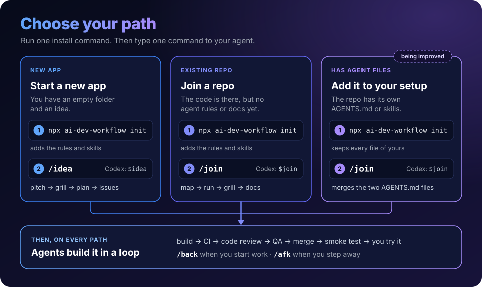

<p align="center">
  
</p>

<p align="center">
  <a href="#-quick-start"></a>
  <a href="#-quick-start"></a>
  <a href="LICENSE"></a>
</p>

<p align="center">
  <b>Install the kit with one command. Type <code>/idea</code>. Get grilled, get a plan, and watch agents build, check, review, merge and test it.</b>
</p>

<p align="center">
  <a href="#-quick-start">Quick start</a> ·
  <a href="#-how-it-works">How it works</a> ·
  <a href="#-the-tracer-bullet-pyramid">The pyramid</a> ·
  <a href="#-model-routing">Model routing</a> ·
  <a href="#-stack-packs-and-add-ons">Packs</a> ·
  <a href="#-guardrails">Guardrails</a> ·
  <a href="guide/cheat-sheet.md"><b>Cheat sheet</b></a>
</p>

---

## 🤔 Why this exists

An AI coding agent does what you tell it. Where you say nothing, it guesses. It takes the first solution that works, invents its own UI components, and builds features nobody asked for.

This kit tells it. It has three parts:

| Part | What it is | When it loads |
|---|---|---|
| [`AGENTS.md`](AGENTS.md) | 13 standing rules and a stop-and-ask list | Every session |
| 26 skills | Step-by-step instructions, one job each | When a request names the skill |
| Guardrails | CI checks and blocked git commands | Always. They don't depend on a prompt. |

It's small on purpose: the kit adds about 3k tokens to a session ([evidence](guide/evidence.md)). The workflow goes:

> **Decide the product → decide the tech → slice it thin → let agents build, check, review and test → you try it → repeat.**

It's the workflow I use to run several apps at once alongside a full-time contract.

---

## ⚡ Quick start

You need Node 22 or newer, and Claude Code or Codex.

<p align="center">
  
</p>

### Path 1 · Start a new app

1. **Make an empty folder and install the kit.**
   ```bash
   mkdir my-app && cd my-app
   npx ai-dev-workflow init
   ```
   It prints how many files it added and a short `Next:` list. Then it asks to start Claude Code (or Codex) right there with `/idea`. Say yes, and your terminal becomes that session.
2. **Or open Claude Code or Codex in the folder yourself and type `/idea`** (Codex: `$idea`). In the desktop app or an IDE, open the folder and start a new session. In Codex, mark the project as trusted when it asks, so `.codex/` loads, then run `/hooks` and trust the kit's hooks (again after a kit update changes them). On Windows, open Codex at the repo root.
3. **Say yes or no to a profile.** The first time, it offers to save what never changes for you: GitHub owner, naming style, stack picks, models, risk dial. Later apps confirm those in one round.
4. **Pitch it, then get grilled.** It plays your idea back in 3–5 lines. Then it asks which preset fits (`saas`, `internal-tool`, `content-site`, `marketplace`, `api-service`) and asks three questions a round, each with a recommended answer.
5. **Pick the MVP, a name and the tech.** You choose the one core piece. It runs `git init`, asks before it makes a GitHub repo, and recommends a stack you can change.
6. **Read the plan.** It asks before it uses your strongest model. If you're on another model, it tells you to open a new session on that one and type `/back`. Then it writes the slices, schema, API and wireframes to `docs/`, and turns them into issues.
7. **Say "start the loop".** Slice 0 goes first: an agent applies a [stack pack](#-stack-packs-and-add-ons), sets up CI and a test deploy, and wires your keys. Then agents build issue by issue. You get "ready to try" with what was tested and screenshots.

Need a break? Stop any time. Every step saves to files, and `/back` picks up where you stopped.

### Path 2 · Join a repo that isn't set up yet

1. **Install the kit in the repo's root.**
   ```bash
   npx ai-dev-workflow init
   ```
2. **Open Claude Code or Codex there and type `/join`** (Codex: `$join`).
3. **Watch it learn the repo.** It reads first, and runs nothing from the repo's own instruction files until you confirm them. It writes a one-page `docs/map.md`. Then it installs, builds, tests and starts the app, and records the commands that work.
4. **Answer what the code can't say:** what's live, what's fragile, how changes ship, who else works here.
5. **Read the hand-off.** You get `docs/`, one short `AGENTS.md`, and the three things it would fix or build first.

> [!WARNING]
> **Didn't write the repo?** Before you open an agent in it, look over its `.claude/`, `.codex/` and editor settings and its git hooks. Those load as soon as the agent starts.

### Path 3 · Add it to a repo with its own agent files

`init` never overwrites a file of yours. It lists each one it kept.

| You already have | What `init` does |
|---|---|
| `AGENTS.md` | Keeps yours. The kit's arrives as `AGENTS.kit.md`. |
| `CLAUDE.md` | Keeps yours. Adds the line `@AGENTS.md` if it's missing. |
| `.claude/settings.json` | Keeps yours. Adds the kit's `deny` rules to it. |
| `.codex/config.toml` | Keeps yours. The kit's arrives as `.codex/config.kit.toml`. |
| A skill, or any other file, at the same path | Keeps yours. The kit's copy arrives next to it as `<file>.kit-new`. |

Then type `/join`. It merges `AGENTS.kit.md` into your `AGENTS.md` and shows you the diff before it commits.

📄 **[Step by step: add the kit to an app that already exists →](guide/add-to-existing-app.md)** The one prompt to give an agent, what `/join` asks, and how to review it all as one pull request.

> [!NOTE]
> 🚧 **Being improved.** Today `/join` merges only the two `AGENTS.md` files. You compare each `.kit-new` and `config.kit.toml` copy by hand, keep what you want, and delete the copy. We're researching a better way to merge two sets of skills.

### Other ways to install

<details>
<summary><b>Paste a prompt</b> into Claude Code or Codex</summary>

```text
Install the AI-Dev-Workflow kit from https://github.com/jsmigendevelopment/AI-Dev-Workflow into this folder: copy AGENTS.md, CLAUDE.md, .agents/, .claude/, .codex/ and .github/ISSUE_TEMPLATE/. Don't overwrite an existing AGENTS.md or CLAUDE.md; show me what you'd merge instead. Then tell me which command to type next.
```

</details>

<details>
<summary><b>Copy the files yourself</b> (macOS, Linux, Windows)</summary>

macOS / Linux:

```bash
git clone --depth 1 https://github.com/jsmigendevelopment/AI-Dev-Workflow /tmp/ai-dev-workflow
cp /tmp/ai-dev-workflow/AGENTS.md /tmp/ai-dev-workflow/CLAUDE.md .
cp -r /tmp/ai-dev-workflow/.agents /tmp/ai-dev-workflow/.claude /tmp/ai-dev-workflow/.codex .
mkdir -p .github && cp -r /tmp/ai-dev-workflow/.github/ISSUE_TEMPLATE .github/
```

Windows (PowerShell):

```powershell
git clone --depth 1 https://github.com/jsmigendevelopment/AI-Dev-Workflow "$env:TEMP\ai-dev-workflow"
Copy-Item "$env:TEMP\ai-dev-workflow\AGENTS.md", "$env:TEMP\ai-dev-workflow\CLAUDE.md" .
Copy-Item -Recurse "$env:TEMP\ai-dev-workflow\.agents", "$env:TEMP\ai-dev-workflow\.claude", "$env:TEMP\ai-dev-workflow\.codex" .
New-Item -ItemType Directory -Force .github | Out-Null; Copy-Item -Recurse "$env:TEMP\ai-dev-workflow\.github\ISSUE_TEMPLATE" .github
```

Already have an `AGENTS.md`? Copy the kit's in as `AGENTS.kit.md`. Already have a `CLAUDE.md`? Keep yours and add the line `@AGENTS.md`.

</details>

### The CLI, after install

The [CLI reference](cli/README.md) has every command and flag.

| Command | What it does |
|---|---|
| `npx ai-dev-workflow init --global` | Copies `idea`, `join`, `back` and `afk` into your own skills folders, so `/idea` works in any folder. Never overwrites. |
| `npx ai-dev-workflow@latest update` | Brings in a newer kit. Files you changed are kept. `--dry-run` shows the plan first. |
| `npx ai-dev-workflow doctor --fix` | Checks your tools, sign-ins and env var names. Offers a fix for each problem and runs it only after you type `y`. |
| `npx ai-dev-workflow profile init` | Makes your personal profile, `~/.ai-dev-workflow/profile.toml`. |
| `npx ai-dev-workflow add tanstack-start` | Copies a stack pack into the project. `add --list` shows every pack. |
| `npx ai-dev-workflow add tanstack-start --list-addons` | Lists that pack's add-ons. |

---

## 💬 The four commands

| | Claude Code | Codex | Type it when | What it does |
|---|---|---|---|---|
| 💡 | [**`/idea`**](.agents/skills/idea/SKILL.md) | `$idea` | You have an idea for a new app | Pitch → grill → MVP → name → tech → plan → issues |
| 🧭 | [**`/join`**](.agents/skills/join/SKILL.md) | `$join` | You're new to a repo that isn't set up | Map the repo → run it → grill you → write `AGENTS.md` and `docs/` |
| ☀️ | [**`/back`**](.agents/skills/back/SKILL.md) | `$back` | You start work, or come back | What changed while you were away → who else is working → what to do first |
| 🌙 | [**`/afk`**](.agents/skills/afk/SKILL.md) | `$afk` | You step away | How long? → usage check → safe rules → keeps building until a hard stop |

That's all you type. The other 22 skills are called for you.

📄 **[Cheat sheet →](guide/cheat-sheet.md)** Trigger phrases, the routing table, the risk dial, and how to run one step yourself.

---

## 🔁 How it works

<p align="center">
  
</p>

| # | Step | What happens | Saved to `docs/` |
|---|---|---|---|
| 1 | **Pitch** | You describe the idea in your own words. | |
| 2 | **Product grill** | Six topics, about 10 questions each. It covers what people forget: sign-up, deleting data, payments, accessibility. | `vision.md`, `features.md`, `decisions.md` |
| 3 | **MVP** | The one core piece that makes the app stand out. You pick it. It's never a default. | `mvp.md` |
| 4 | **Name + repo** | 5–7 name ideas, `git init`, and a GitHub repo if you want one. | |
| 5 | **Tech grill** | Platform, stack, folders, API pattern, data, auth, environments, CI, risk dial. A beginner accepts. An expert overrides. | `stack.md`, `architecture.md`, `security-policy.md` |
| 6 | **CTO plan** | The strongest model plans slice 0, the pyramid and the milestones. It designs the schema, API and wireframes. | `pyramid.md`, `design.md` |
| 7 | **Issues** | Each has acceptance checks tagged `auto` (CI runs them) or `agent` (an agent clicks through them), an out-of-scope fence, dependencies, risk flags and a lane. | GitHub issues |
| 8 | **Build loop** | One fresh agent per issue. Other fresh agents review and test it. Nobody checks their own work. | `state.md`, one line per merge |
| 9 | **You try it** | Each point of feedback becomes a new issue. | |

---

## 🔺 The tracer-bullet pyramid

<p align="center">
  
</p>

The old way builds the whole schema, then the whole API, then the whole UI. You see nothing until the end. **Tracer bullets** are thin slices that each go all the way through. You can use something real after the first one, and steer while it's cheap.

The MVP isn't one slice or one pass, so the slices **stack**:

- **Slice 0** is the skeleton: the app runs, CI checks every pull request, and main deploys to test.
- **Pass 1** is wide and thin: every slice works end to end.
- **Each pass up** is narrower and deeper.
- **The core** gets the most passes and the most effort.

→ [The `pyramid` skill](.agents/skills/pyramid/SKILL.md)

---

## 🧠 Model routing

The strongest model on high effort for every job is slow and burns your limits. The cheapest model for every job ships junk. So each job gets a tier and an effort.

| Tier | Jobs | Example <sub>(checked 2026-11)</sub> |
|---|---|---|
| **Strongest** · high effort | The CTO jobs: research, the pyramid, schema, API, wireframes | Fable 5.2 |
| **Everyday** · low or medium effort | Talking, grilling, writing issues, building, reviewing, browser checks | Opus 5.5 |
| **Creative** | Art, visuals, names | ChatGPT |
| **Second opinion** | A second reviewer when a risky change touches personal data or money | Another vendor's model |

- **It asks before it uses the strongest tier.** You can turn the question off in your profile.
- **Start low. Go up one step only after a verified failure:** a failed check or a rejected review.
- **A reviewer never runs below the builder's effort.** More effort isn't always better. In a small test, a low-effort reviewer caught 16 of 17 planted bugs. The same model on high effort caught 15 and took 2.3× as long.

→ [Job-by-job table](guide/cheat-sheet.md#-model-routing) · [The `routing` skill](.agents/skills/routing/SKILL.md)

---

## 📦 Stack packs and add-ons

The tech grill recommends a stack and shows alternatives. Take the picks or swap any of them. For a web app:

| | Recommended | Why | Alternatives |
|---|---|---|---|
| Framework | **TanStack Start** (React, TypeScript) | Typed, and not tied to one host | React Router, SvelteKit |
| UI | **shadcn/ui + Tailwind** | Without a kit, AI invents its own components | Mantine, Radix |
| Structure | **Feature folders** (`src/modules/<feature>/`) | A feature's UI, hooks, server code and schemas live together | By layer, for tiny apps |
| API | **Controller → service → repository** | Easy to test, easy to swap parts | tRPC, GraphQL |
| Data | **SQLite** (Cloudflare D1) with Drizzle | Free and simple | Supabase Postgres, Convex |
| Auth | **Clerk** | Don't build auth. Buy it. | Supabase Auth, Better Auth |
| Hosting | **Cloudflare Workers** | A free tier, and domains at cost | Netlify |
| Tests | **Vitest + Playwright** | Unit tests for logic, a real browser for flows | Jest |

**Build or buy, in this order:** open source → a SaaS with a free tier → build it yourself.

A **stack pack** is that stack already working: configs, the folder skeleton, an example module through every layer, CI, and the checks. At slice 0 the agent pulls it into your project. No pack for your stack? The agent sets up the same things by hand and offers to save the result as a new pack.

| Pack | Status | What's in it |
|---|---|---|
| [`tanstack-start`](stacks/tanstack-start/) | Ready | The web stack above. It runs, tests and builds with no accounts and no keys. Security headers, rate limits, accessibility checks and SEO files are on from the start. |
| [`monorepo-expo`](stacks/monorepo-expo/) | Ready | One repo for web and mobile: an Expo app for iOS and Android, the web pack in `apps/web`, and one API contract both follow. |
| [`electron-desktop`](stacks/electron-desktop/PACK.md) · [`python-fastapi`](stacks/python-fastapi/PACK.md) · [`unity`](stacks/unity/PACK.md) | Stub | Researched and fact-checked in 2026-11. Not built yet. The agent builds the starter in your project from `PACK.md`. |

**Add-ons** are optional pieces for the `tanstack-start` pack. The tech grill offers one only when the app needs it. With no keys set, the app still builds and the feature stays off.

| Add-on | Adds | Lane |
|---|---|---|
| [`analytics`](stacks/tanstack-start-addons/analytics/ADDON.md) | Cloudflare Web Analytics | tiny |
| [`sentry`](stacks/tanstack-start-addons/sentry/ADDON.md) | Error reports from the server and the browser | normal |
| [`jobs`](stacks/tanstack-start-addons/jobs/ADDON.md) | Background jobs and schedules | normal |
| [`email-resend`](stacks/tanstack-start-addons/email-resend/ADDON.md) | Sending email through Resend | risky |
| [`stripe`](stacks/tanstack-start-addons/stripe/ADDON.md) | Checkout, the customer portal and a signed webhook, in test mode | risky |
| [`r2-uploads`](stacks/tanstack-start-addons/r2-uploads/ADDON.md) | File uploads to Cloudflare R2, scoped to the owner | risky |
| [`database-supabase`](stacks/tanstack-start-addons/database-supabase/ADDON.md) | A move from D1 to Supabase Postgres | risky |

**The check contract:** every project has the same six commands, whatever the stack: `check`, `lint`, `typecheck`, `test`, `test:e2e`, `build`. The skills, CI and the loop call only those.

---

## 🔒 Guardrails

| Guardrail | How it works |
|---|---|
| **Always waits for you** | Production, secrets, deleting or migrating real data, and spending money. No setting turns this off. |
| **The risk dial** | Move fast, careful or strict. It decides who merges: agents, or you. → [Dial and lanes](guide/cheat-sheet.md#-risk-dial-and-lanes) |
| **CI on every pull request** | The checks, a secret scan, and a guard that blocks changes to the agents' own rules until you add the `human-approved` label. |
| **No force pushes, no pushes to main** | Blocked in the tool, so it works on free private repos, where GitHub won't protect branches. Claude Code: `.claude/settings.json`. Codex: `.codex/rules/git-safety.rules`. Codex rules match only the start of a command, so a `--force` typed after the branch name is caught by rule 12 in `AGENTS.md` instead. |
| **A boundary check in lint** | One feature can't import another. The architecture holds because a check enforces it, not because a prompt asks. |
| **Keys never go through chat** | The `secrets` skill lists each variable and where to get it. It gives you the commands, or it pushes your values from a git-ignored file to GitHub and Cloudflare without printing them. |
| **No silent waiting** | A rate-limited or blocked agent tells you right away, keeps doing other work, and resumes after the reset. |
| **Every session starts informed** | A Claude Code hook gives the session the branch, the last commit and `docs/state.md` before you type. Local files only. |
| **Pings when it needs you** | A Claude Code hook shows a desktop notification on macOS, Windows or Linux. Set `NTFY_TOPIC` to get it on your phone through the free ntfy app. |
| **One `/afk` covers every thread** | `/afk` in one thread tells the other threads on the machine that you're away. The first `/back` after it tells them you're back. |
| **Work hours, if you want them** | Off by default. Turn on `[worklog]` in your profile. Your first prompt starts the clock and `/afk` stops it, across every thread. Forget to `/afk`? After 8 quiet hours it stops at your last prompt, and the report flags it. The log lives in your home folder or a Google Drive folder, never in the repo. Cloud sessions can add to a Google Sheet. `node .agents/skills/afk/scripts/worklog.mjs report` shows your hours. |

**GitHub setup, done for you.** At slice 0 the agent runs `setup-github.mjs --dry-run`, shows you the list, and asks before it applies it. It turns on what your plan allows and says what it skipped.

| Sets up | Free plan | GitHub Team |
|---|---|---|
| The workflow's labels, Dependabot alerts and security-fix PRs | ✅ | ✅ |
| Rules on main: PR only, no force push, green checks required | public repos | ✅ |
| `test` and `production` environments. Production deploys only from main and waits for your approval. | public repos | ✅ |
| Secret scanning and push protection | public repos | add-on for private |

---

## 💡 Principles

- **Don't *let* it ask. *Make* it ask.** Told it *may* ask, it asked in 4 of 24 conversations. Told to **ask three**, builds that matched the intent went from 7 of 24 to 19 of 24.
- **Name the skill.** Skills nobody mentioned loaded 0 of 40 times on a small model. One sentence naming the skill got 20 of 20. So you type the command, every issue has a `Skills:` line, and every skill names the next one.
- **"Done" is a claim.** In one benchmark, 52% of failed steps had been reported complete. So someone other than the builder runs the checks.
- **The reviewer reads the diff, not the story.** Given a pull request description written to persuade, AI reviewers accepted 32 of 33 reintroduced known vulnerabilities. Given neutral text, 4 of 33.
- **AI finds *a* solution, not *the* solution.** That's what the grill, three options and research are for.
- **Product before tech.** You can't pick a stack before you know if it's a website or a phone app.
- **Decisions live in files.** Chats end. A fresh session must be able to take over from the repo alone.

Most of these numbers come from small tests on small models. Treat them as strong hints, not laws.

📄 [All 10 principles](guide/principles.md) · 📊 [The evidence behind them](guide/evidence.md) · 🔑 [Trigger phrases](guide/cheat-sheet.md#-trigger-phrases)

---

## 📁 What's in here

```
AGENTS.md                  ← rules every agent follows, every session (Codex + Claude)
CLAUDE.md                  ← one line: @AGENTS.md
.agents/skills/            ← the 26 skills, master copy (Codex reads this)
.claude/skills/            ← the same skills (Claude Code reads this)
.claude/settings.json      ← Claude Code: blocked git commands and hooks
.claude/hooks/             ← Claude Code: session-start and notify hooks
.codex/                    ← Codex: settings, command rules, and the same hooks (hooks.json)
.github/ISSUE_TEMPLATE/    ← the slice issue template
stacks/                    ← stack packs and add-ons, pulled in at slice 0
cli/                       ← the npx ai-dev-workflow command
guide/                     ← cheat sheet, principles, evidence (for people)
assets/                    ← diagrams
scripts/sync-skills.mjs    ← keeps the two skill copies identical
```

| Skills | |
|---|---|
| **You type** (4) | [`idea`](.agents/skills/idea/SKILL.md) · [`join`](.agents/skills/join/SKILL.md) · [`back`](.agents/skills/back/SKILL.md) · [`afk`](.agents/skills/afk/SKILL.md) |
| **Planning** (8) | [`grill`](.agents/skills/grill/SKILL.md) · [`name`](.agents/skills/name/SKILL.md) · [`stack`](.agents/skills/stack/SKILL.md) · [`secrets`](.agents/skills/secrets/SKILL.md) · [`research`](.agents/skills/research/SKILL.md) · [`pyramid`](.agents/skills/pyramid/SKILL.md) · [`issues`](.agents/skills/issues/SKILL.md) · [`routing`](.agents/skills/routing/SKILL.md) |
| **The loop** (5) | [`coordinate`](.agents/skills/coordinate/SKILL.md) · [`build`](.agents/skills/build/SKILL.md) · [`pr-review`](.agents/skills/pr-review/SKILL.md) · [`pr-security`](.agents/skills/pr-security/SKILL.md) · [`qa`](.agents/skills/qa/SKILL.md) |
| **Know-how**, named in issues (5) | [`web-performance`](.agents/skills/web-performance/SKILL.md) · [`web-security`](.agents/skills/web-security/SKILL.md) · [`seo`](.agents/skills/seo/SKILL.md) · [`a11y`](.agents/skills/a11y/SKILL.md) · [`dependencies`](.agents/skills/dependencies/SKILL.md) |
| **Stack packs** (2) | [`stack-tanstack-start`](.agents/skills/stack-tanstack-start/SKILL.md) · [`stack-monorepo-expo`](.agents/skills/stack-monorepo-expo/SKILL.md) |

**Editing a skill?** Edit it in `.agents/skills/`, then run `node scripts/sync-skills.mjs`. CI fails if the two copies drift apart.

---

<p align="center">
  <sub>Built and battle-tested by</sub><br><br>
  <a href="https://me.jsmigen.dev"><b>✦ jay ✦</b></a><br>
  <sub>Jay Smigen · software engineer · New Jersey</sub><br><br>
  <a href="https://me.jsmigen.dev">me.jsmigen.dev</a> ·
  <a href="https://jsmigen.dev">jsmigen.dev</a> ·
  <a href="https://www.linkedin.com/in/jayson-smigen/">LinkedIn</a> ·
  <a href="https://github.com/Jay-Smi">GitHub</a>
  <br><br>
  <sub>Made for the builders. Go ship something. ✌️</sub>
</p>
