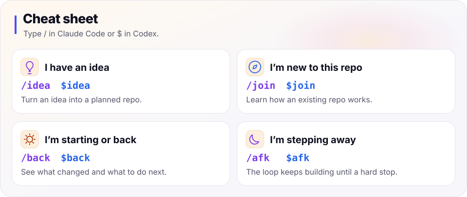

  

## ⌨️ Commands

| | Claude Code | Codex | Use it when | Or just say |
|---|---|---|---|---|
| 💡 | **`/idea`** | `$idea` | You have an idea for a new app | "I have an idea for an app" |
| 🧭 | **`/join`** | `$join` | You're new to a repo that isn't set up yet | "Help me get set up in this repo" |
| ☀️ | **`/back`** | `$back` | You're starting work, or back from a break | "I'm back" · "pick up where we left off" |
| 🌙 | **`/afk`** | `$afk` | You're stepping away and want it to keep building | "brb" · "good night" |

> [!TIP]
> **Typing the command always works.** The plain phrase usually does, on a strong model.

---

## 🔑 Trigger phrases

| Say | Get |
|---|---|
| "Grill me. Three questions at a time, each with your recommended answer." | A real interview instead of silent guesses |
| "Give me three options with trade-offs and a recommendation." | Choices, not the first idea it had |
| "Use the `<name>` skill." | That skill, every time |
| "Tracer bullets" · "vertical slices" | Thin, end-to-end features you can try right away |
| "Modular monolith" | Feature modules you can split out later |
| "Controller → service → repository" | An API that's easy to test and swap parts in |
| "Review the diff in a fresh context. Don't read the description." | A reviewer that judges the code, not the story |
| "What's out of scope?" | A fence, so it doesn't wander |

---

## 🧠 Model routing

Example setup, checked 2026-11. Swap in your own models.

| Job | Tier · effort | Example |
|---|---|---|
| 🗣️ Your live thread (the loop) | Everyday · low | Opus 5.5 low |
| 🔥 Grill, planning chat | Everyday · medium | Opus 5.5 medium |
| 🏛️ CTO: research, pyramid, schema, API, wireframes | **Strongest · high** | Fable 5.2 high |
| 📋 Writing issues from the plan | Everyday · medium | Opus 5.5 medium |
| 🔨 Build pass 1 | Everyday · low | Opus 5.5 low |
| ✨ Build pass 2+ | Everyday · medium | Opus 5.5 medium |
| 🔍 Code review | Never below the builder | Opus 5.5 low / medium |
| 🛡️ Security review (risky only) | One step above review, plus a second vendor for personal data or money | Opus 5.5 medium + ChatGPT |
| 🎨 Art | Creative | ChatGPT |

**Start low. Escalate one step only after a verified failure.**

---

## 🎚 Risk dial and lanes

| Dial | Who merges | Pick it when |
|---|---|---|
| 🟢 **Move fast** | Agents, after the checks pass | Side project or startup, no real users yet |
| 🟡 **Careful** | Agents. The person reads schema and API changes first. | Real users or real money |
| 🔴 **Strict** | The person approves every merge | Bank, health, anything regulated |

| Lane | Checks before merge | When |
|---|---|---|
| **tiny** | CI · code review | Copy, styling, config. No logic. |
| **normal** | CI · code review · QA on the preview | Most issues |
| **risky** | Normal · security review · the person | Auth, secrets, personal data, money, migrations, new dependencies |

🛑 **Always waits for a person, whatever the dial:** production, secrets, deleting or migrating real data, and spending money.

---

<a href="../README.md">← Back to the README</a> · made by <a href="https://me.jsmigen.dev">jay</a>

